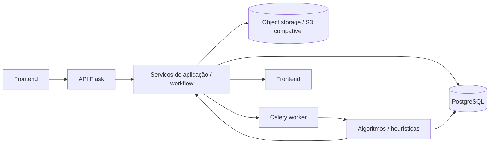

# Arquitetura do projeto

Este documento consolida a visão arquitetural do projeto, reunindo os principais pontos documentados no README, na especificação do workflow de instâncias, na documentação de algoritmos e no modelo de persistência.

## 1. Visão geral

O sistema foi desenhado para separar claramente:

- a interface do usuário;
- a API e os serviços de aplicação;
- o domínio de otimização e workflow de instâncias;
- os algoritmos de resolução;
- a persistência em banco de dados;
- o processamento assíncrono e a execução de jobs.

A arquitetura segue uma abordagem modular, com baixo acoplamento entre camada de apresentação, camada de domínio e implementações concretas de algoritmos.

## 2. Objetivos da arquitetura

Os principais objetivos são:

- permitir criação de instâncias de problema a partir de arquivos externos;
- validar e persistir dados de entrada;
- executar algoritmos de otimização de forma assíncrona;
- manter histórico de execuções, resultados e notificações;
- oferecer visualização de soluções e análise multiobjetivo;
- manter os modelos matemáticos independentes da API, do banco e do frontend.

## 3. Componentes principais

### 3.1 Frontend

Localização: `frontend/`

Responsabilidades:

- permitir seleção de tipo de problema;
- upload de arquivos de entrada;
- criação e gerenciamento de instâncias;
- visualização de métricas, gráficos e tabelas;
- acompanhamento de execução e de notificações.

Tecnologias:

- HTML
- CSS
- JavaScript vanilla
- interface local e sem autenticação na versão atual

O frontend consume a API REST em `/api/v1` e interage com JSON e CSV, conforme descrito no workflow de instâncias.

### 3.2 API e serviços de aplicação

Localização: `src/api/`, `src/workflow_instance/`, `src/infrastructure/`

Responsabilidades:

- expor endpoints HTTP;
- validar payloads e regras de negócio;
- orquestrar criação de instâncias, uploads e execuções;
- consultar o banco;
- disparar ou monitorar jobs assíncronos;
- entregar resultados para o frontend.

A API é implementada com Flask e integra diretamente com:

- a camada de persistência PostgreSQL;
- a camada de workflow de instâncias;
- o worker do Celery.

### 3.3 Workflow de instâncias e domínio

Localização: `src/workflow_instance/`

Responsabilidades:

- definir a lógica de criação e análise de instâncias;
- manter a semântica de dados do problema;
- interpretar matrizes CSV, layouts, objetivos e configurações;
- controlar a geração de fronteira e análise de resultados.

Essa camada concentra regras de domínio e execução do problema, mantendo a lógica de negócio separada da interface HTTP e dos algoritmos específicos.

### 3.4 Modelos matemáticos dos problemas

Localização: `src/optimization_problems/`

Responsabilidades:

- modelar formalmente o problema de otimização;
- definir a estrutura da instância e as representações do problema;
- construir modelos em Pyomo para cada família de problema.

A organização segue a família do problema, por exemplo:

- `optimization_problems/tsp/`

Conforme a documentação de algoritmos, essa camada deve ser independente de Flask, Celery, banco de dados e armazenamento.

### 3.5 Algoritmos monoobjetivo

Localização: `src/monoobjective_algorithms/`

Responsabilidades:

- resolver uma instância em um único objetivo;
- compartilhar uma interface comum entre implementações;
- encapsular heurísticas e solvers específicos.

Exemplos:

- heurísticas de TSP;
- solver exato, quando aplicável;
- adaptadores para integração com bibliotecas externas.

A arquitetura exige que todos os solvers sigam um contrato comum de entrada/saída (`solve`), com capacidade explícita e resultado padronizado.

### 3.6 Algoritmos multiobjetivo

Localização: `src/multiobjective_algorithms/`

Responsabilidades:

- comparar soluções por dominância;
- gerar ou analisar fronteiras de Pareto;
- aplicar métricas e métodos de análise multiobjetivo;
- receber um solver monoobjetivo por interface, sem depender da implementação concreta.

Módulos relevantes:

- dominância;
- medidas de qualidade e espalhamento;
- robustez e hipervolume;
- geração de ponto de referência.

### 3.7 Persistência

Localização: `src/infrastructure/persistence/postgres/`

Tecnologia:

- SQLAlchemy
- PostgreSQL

Responsabilidades:

- persistir instâncias, uploads, layouts, execuções e soluções;
- manter o estado da aplicação;
- guardar progresso de execução, resultados, notificações e metadados de arquivos.

A modelagem persistida está documentada em [docs/database/estrutura_banco.md](docs/database/estrutura_banco.md) e resumida em seções abaixo.

### 3.8 Worker e processamento assíncrono

Localização: `src/worker/`

Tecnologia:

- Celery
- Redis

Responsabilidades:

- executar tarefas longas em background;
- processar otimização de instâncias assíncronamente;
- atualizar status, progresso e resultados;
- aceitar cancelamento cooperativo.

A arquitetura separa claramente o banco e o estado da execução da fila de tarefas: o PostgreSQL é a fonte de verdade do estado, enquanto o Celery/Redis transporta e orquestra a execução.

## 4. Fluxo arquitetural principal

### 4.1 Fluxo de criação e execução de instância



### 4.2 Fluxo do usuário

1. O usuário envia arquivos de entrada pelo frontend.
2. A API valida o conteúdo e grava metadados no banco.
3. A instância é criada e associada aos arquivos.
4. O usuário seleciona algoritmo e parâmetros.
5. Uma execução assíncrona é criada em `runs`.
6. O worker executa o algoritmo e persiste progresso/soluções.
7. O sistema publica resultados e notificações.
8. O frontend consulta o estado e os resultados finalizados.

## 5. Estrutura de pastas do projeto

```text
.
├── data/
│   └── instances/
├── docs/
│   ├── algorithms/
│   ├── database/
│   ├── dev_report/
│   ├── features/
│   └── papers/
├── frontend/
├── migrations/
├── notebooks/
├── src/
│   ├── api/
│   ├── infrastructure/
│   ├── monoobjective_algorithms/
│   ├── multiobjective_algorithms/
│   ├── optimization_problems/
│   ├── worker/
│   └── workflow_instance/
├── tests/
├── README.md
├── visao.md
├── arquitetura.md
├── compose.yaml
├── compose-dev.yaml
└── requirements*.txt
```

## 6. Modelo de dados principal

O banco principal é PostgreSQL e o modelo de persistência cobre o ciclo completo do sistema:

- `temporary_uploads`: arquivos recebidos antes da criação da instância;
- `instances`: metadados da instância e configuração;
- `instance_files`: mapeamento da instância para arquivos de entrada;
- `city_layouts`: coordenadas das cidades para visualização;
- `runs`: execuções assíncronas e estado do job;
- `run_solutions`: soluções geradas pela execução;
- `run_attempt_samples`: amostras por tentativa/round;
- `notifications`: mensagens e eventos do sistema.

Detalhes completos estão em [docs/database/estrutura_banco.md](docs/database/estrutura_banco.md).

## 7. Padrões e decisões arquiteturais

### 7.1 Separação por responsabilidades

A arquitetura procura manter cada módulo com uma responsabilidade clara:

- frontend: apresentação;
- API: HTTP e orquestração;
- workflow: regras de negócio e domínio;
- algorithms: otimização e análise;
- persistence: armazenamento e recuperação; 
- worker: execução em background.

### 7.2 Independência dos algoritmos

Os pacotes de algoritmo devem ser independentes dos adaptadores HTTP, Celery e banco de dados. Isso permite que a lógica de otimização seja testada e reutilizada sem depender da infraestrutura.

### 7.3 Persistência como fonte de verdade

O PostgreSQL é a fonte oficial do estado do sistema, incluindo:

- instâncias;
- uploads e arquivos;
- progresso da execução;
- resultados calculados;
- notificações e histórico.

### 7.4 Execução assíncrona

Execuções longas não ficam bloqueadas no HTTP. Em vez disso, a API cria um registro de execução e o worker processa em background. Isso favorece respostas rápidas e melhor experiência de uso.

## 8. Documentação de referência

As informações desta arquitetura foram consolidadas com base nas seguintes fontes do projeto:

- [README.md](README.md)
- [visao.md](visao.md)
- [docs/features/workflow_instance/README.md](docs/features/workflow_instance/README.md)
- [docs/algorithms/README.md](docs/algorithms/README.md)
- [docs/database/estrutura_banco.md](docs/database/estrutura_banco.md)

## 9. Conclusão

A arquitetura atual do projeto organiza o sistema em camadas bem definidas, com foco em modularidade, separação de responsabilidades e execução assíncrona de otimização. Essa abordagem facilita evolução do sistema, substituição de componentes e integração entre front-end, domínio, algoritmos e infraestrutura.
