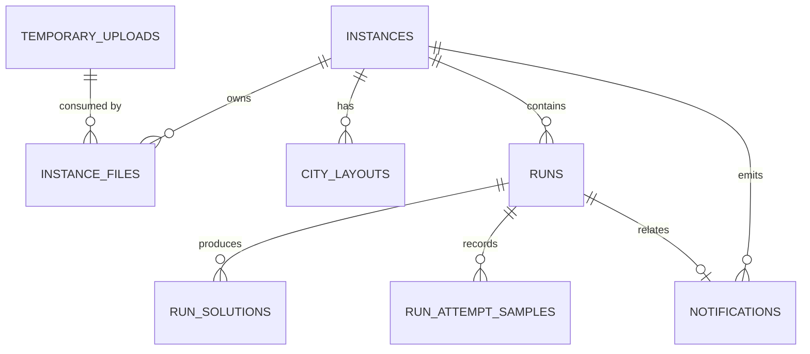

# Estrutura do banco de dados

Este documento consolida a modelagem persistida no PostgreSQL do projeto e serve como referência oficial da estrutura de dados atualmente implementada.

## Fonte de verdade

A estrutura real está definida nos modelos SQLAlchemy em:

- `src/infrastructure/persistence/postgres/models/instance.py`
- `src/infrastructure/persistence/postgres/models/upload.py`
- `src/infrastructure/persistence/postgres/models/layout.py`
- `src/infrastructure/persistence/postgres/models/run.py`
- `src/infrastructure/persistence/postgres/models/solution.py`

E as migrações do Alembic em:

- `migrations/versions/0001_initial.py`
- `migrations/versions/0002_temporary_uploads.py`
- `migrations/versions/0003_instances.py`
- `migrations/versions/0004_runs_results.py`
- `migrations/versions/0005_solution_rounds.py`
- `migrations/versions/0006_solution_timings.py`
- `migrations/versions/0007_run_attempt_samples.py`

## Visão geral

O banco trata principalmente de quatro blocos de dados:

1. Uploads temporários e arquivos de entrada
2. Instâncias de problema e seu layout geográfico
3. Execuções de otimização (`runs`)
4. Soluções e amostras geradas por execução

Abaixo está o modelo conceitual principal:

## Tabelas

### 1. temporary_uploads

Armazena arquivos enviados antes de a instância ser criada ou antes de o arquivo ser consumido definitivamente.

| Campo | Tipo | Descrição |
|---|---|---|
| id | VARCHAR(40) | Identificador primário |
| problem_type_id | VARCHAR(100) | Tipo de problema associado |
| catalog_version | VARCHAR(32) | Versão do catálogo |
| role | VARCHAR(64) | Papel do arquivo, como `time_matrix` ou `distance_matrix` |
| original_filename | VARCHAR(255) | Nome original do arquivo |
| object_key | VARCHAR(512) | Chave do objeto no armazenamento externo |
| size_bytes | BIGINT | Tamanho em bytes |
| sha256 | VARCHAR(64) | Hash do conteúdo |
| content_type | VARCHAR(255) | Tipo MIME |
| node_count | INTEGER | Número de nós detectado |
| status | VARCHAR(16) | Estado do upload |
| created_at | TIMESTAMPTZ | Data de criação |
| expires_at | TIMESTAMPTZ | Data de expiração |
| consumed_at | TIMESTAMPTZ | Data de consumo pela instância |

Observações:

- A tabela possui índice em `expires_at`.
- Há restrição única em `object_key`.
- O upload é um estágio transitório; depois que vira parte da instância, ele é associado por `instance_files`.

### 2. instances

Representa uma instância de problema pronta para ser processada por um algoritmo.

| Campo | Tipo | Descrição |
|---|---|---|
| instance_id | VARCHAR(40) | Identificador primário |
| problem_type_id | VARCHAR(120) | Tipo de problema |
| catalog_version | VARCHAR(32) | Versão do catálogo |
| name | VARCHAR(255) | Nome da instância |
| status | VARCHAR(32) | Estado atual da instância |
| configuration | JSON | Configuração persistida da instância |
| node_count | INTEGER | Quantidade de nós/cidades |
| created_at | TIMESTAMPTZ | Data de criação |
| updated_at | TIMESTAMPTZ | Data da última atualização |

Observações:

- `configuration` é um JSON livre, usado para guardar opções da instância e configuração de visualização/algoritmo.
- A tabela registra a instância como unidade central do fluxo do sistema.

### 3. instance_files

Relaciona uma instância aos arquivos que a compõem.

| Campo | Tipo | Descrição |
|---|---|---|
| id | VARCHAR(40) | Identificador primário |
| instance_id | VARCHAR(40) | FK para `instances` |
| upload_id | VARCHAR(40) | FK para o upload original |
| role | VARCHAR(64) | Papel do arquivo (`time_matrix`, `distance_matrix`, etc.) |
| object_key | VARCHAR(512) | Chave do objeto no armazenamento |
| sha256 | VARCHAR(64) | Hash do arquivo |
| size_bytes | INTEGER | Tamanho em bytes |
| created_at | TIMESTAMPTZ | Data de associação |

Observações:

- A restrição `uq_instance_files_instance_role` garante que cada instância não tenha dois arquivos com o mesmo papel.
- Se a instância for apagada, seus arquivos associados devem ser removidos em cascata ou via regra de aplicação.

### 4. city_layouts

Guarda a projeção geométrica das cidades, usada para renderizar visualizações gráficas e analisar a instância em layout.

| Campo | Tipo | Descrição |
|---|---|---|
| id | VARCHAR(40) | Identificador primário |
| instance_id | VARCHAR(40) | FK para `instances` |
| city_index | INTEGER | Índice da cidade dentro da instância |
| x | FLOAT | Coordenada X |
| y | FLOAT | Coordenada Y |

Observações:

- A chave única composta `uq_city_layouts_instance_city` impede duplicação de coordenada para a mesma cidade.
- A tabela mantém a ordem lógica dos nós e serve como base para desenho de rota, gráfico de arcos e análise visual.

### 5. runs

Representa uma execução assíncrona de um algoritmo sobre uma instância.

| Campo | Tipo | Descrição |
|---|---|---|
| run_id | VARCHAR(40) | Identificador primário |
| instance_id | VARCHAR(40) | FK para `instances` |
| algorithm_id | VARCHAR(120) | Identificador do algoritmo |
| status | VARCHAR(32) | Estado da execução |
| parameters | JSON | Parâmetros de execução |
| progress | JSON | Progresso em forma de payload (`completed`, `total`, `percent`) |
| solution_timings | JSON | Timings de solução, quando persistidos |
| idempotency_key | VARCHAR(128) | Chave de idempotência |
| error_message | VARCHAR(512) | Mensagem de erro, se houver |
| created_at | TIMESTAMPTZ | Data de criação da execução |
| started_at | TIMESTAMPTZ | Quando começou |
| finished_at | TIMESTAMPTZ | Quando terminou |
| updated_at | TIMESTAMPTZ | Última atualização de estado |

Observações:

- Há índice em `instance_id` e em `idempotency_key`.
- `status` é usado para controlar fila, execução, cancelamento e conclusão.
- `progress` é persistido em JSON para permitir consulta por API sem recalcular o estado da execução.

### 6. run_solutions

Armazena cada solução produzida por uma execução.

| Campo | Tipo | Descrição |
|---|---|---|
| solution_id | VARCHAR(40) | Identificador primário |
| run_id | VARCHAR(40) | FK para `runs` |
| instance_id | VARCHAR(40) | FK para `instances` |
| objective_values | JSON | Valores dos objetivos da solução |
| route | JSON | Sequência de nós/cidades da rota |
| dominance | VARCHAR(32) | Estado de dominância (`non_dominated`/`dominated`) |
| round_index | INTEGER | Índice do round em que a solução foi produzida |
| created_at | TIMESTAMPTZ | Quando a solução foi persistida |

Observações:

- A tabela guarda soluções finais relacionadas a uma execução e à instância.
- `route` é um array JSON de inteiros ou identificadores de cidade.
- `objective_values` é um JSON serializado com valores por objetivo, por exemplo `{ "time": 12.4, "distance": 430.1 }`.

### 7. run_attempt_samples

Registra amostras de tentativa dentro de um round de execução, preservando a ordem de coleta e suportando reconstrução de prefixos da amostragem.

| Campo | Tipo | Descrição |
|---|---|---|
| sample_id | VARCHAR(40) | Identificador primário |
| run_id | VARCHAR(40) | FK para `runs` |
| round_index | INTEGER | Índice do round |
| attempt_index | INTEGER | Índice da tentativa dentro do round |
| objective_values | JSON | Valores objetivos da amostra |

Observações:

- Existe restrição única por `(run_id, round_index, attempt_index)`.
- Esse armazenamento é importante para reconstruir a ordem temporal da geração de soluções e analisar evolução da amostra.

### 8. notifications

Guarda notificações do sistema ligadas a instâncias e, eventualmente, a execuções.

| Campo | Tipo | Descrição |
|---|---|---|
| notification_id | VARCHAR(40) | Identificador primário |
| instance_id | VARCHAR(40) | FK para `instances` |
| run_id | VARCHAR(40) | FK opcional para `runs` |
| title | VARCHAR(255) | Título da notificação |
| message | VARCHAR(1024) | Mensagem |
| is_read | INTEGER | Indicador de leitura (`0`/`1`) |
| created_at | TIMESTAMPTZ | Data de criação |

Observações:

- A tabela permite rastrear eventos, como conclusão ou falha de execução, ligados a uma instância específica.
- `run_id` pode ser nulo quando a notificação não está vinculada a uma execução.

## Relacionamentos principais

### Fluxo de criação da instância

1. O usuário envia um upload temporário em `temporary_uploads`.
2. A instância é criada em `instances`.
3. Cada arquivo da instância é registrado em `instance_files`.
4. O layout das cidades é persistido em `city_layouts`.

### Fluxo de execução

1. Uma execução é criada em `runs` vinculada a uma instância.
2. O algoritmo avalia a execução e persiste progresso em `progress`.
3. Cada solução gerada é armazenada em `run_solutions`.
4. Cada amostra/attempt pode ser registrada em `run_attempt_samples`.
5. Ao fim da execução, uma notificação pode ser criada em `notifications`.

## Estados e convenções observadas

O projeto usa `VARCHAR` para estados, em vez de enumeração de banco, então os valores são tratados na aplicação. Exemplos:

- instâncias: `ready`, `deleting`, etc.
- runs: `queued`, `running`, `cancel_requested`, `cancelled`, `completed`, `failed`
- notificações: `is_read` em inteiro, interpretado como booleano na aplicação

## Observações de arquitetura

- O banco é o sistema de verdade para estado de execução e metadados de instância.
- A API e o worker consultam o PostgreSQL para recuperar dados e atualizar progresso.
- Os arquivos de entrada ficam em armazenamento complementado pelo banco, que guarda apenas metadados e referências (`object_key`).
- O projeto usa Alembic para versionar o esquema.

## Conclusão

Não existe um documento separado de esquema de banco em nível de visão geral no repositório. A estrutura acima foi inferida diretamente do código e das migrações, e constitui a base de persistência atual do sistema.
