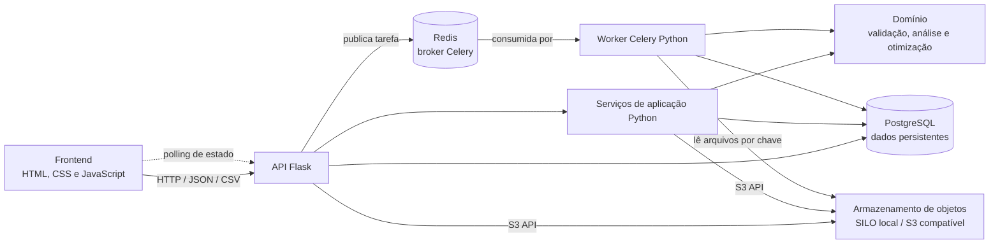
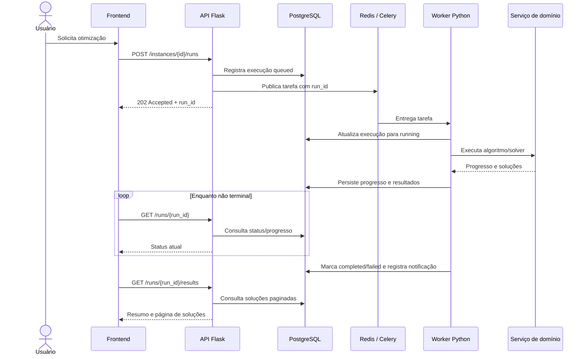
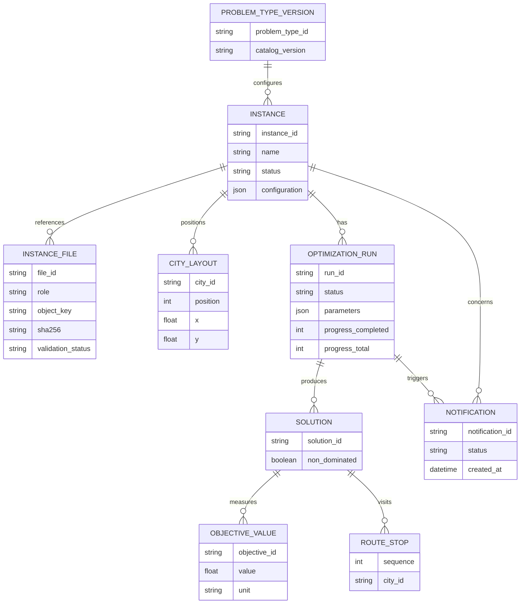

# WORKFLOW_INSTANCE — criação, execução e análise de instâncias

## Objetivo

Especificar o fluxo ponta a ponta para criar uma instância de otimização a partir de arquivos, inspecionar os dados, configurar e acompanhar uma execução assíncrona e analisar seus resultados. O catálogo de tipos de problema determina quais entradas, algoritmos e visualizações estão disponíveis.

Esta especificação documenta o fluxo funcional local do TSP biobjetivo. A API Flask, worker Celery, persistência PostgreSQL, armazenamento S3 compatível e frontend vanilla estão integrados. A heurística v1 gera uma aproximação da fronteira por amostragem; a implantação permanece single-user e local, sem autenticação.

## Catálogo de tipos de problema

O catálogo deve ser a fonte de configuração do fluxo, evitando que telas mantenham listas independentes. Cada tipo publicado deve declarar:

| Informação | Conteúdo |
|---|---|
| Identificação | Código estável, nome, descrição e objetivos com nome, unidade e direção (minimizar/maximizar). |
| Entradas | Arquivos esperados, formato, validações e relação entre arquivos. |
| Análise prévia | Visualizações disponíveis e as entradas consumidas por cada visualização. |
| Solução | Modelos/algoritmos disponíveis, descrição e parâmetros configuráveis, quando aplicável. |
| Análise de resultados | Visualizações disponíveis, dados necessários e interpretações apresentadas. |

O cliente carrega essas opções a partir do catálogo do problema selecionado. A API/domínio deve validar novamente todas as escolhas; uma opção removida ou incompatível não pode ser aceita somente porque a interface a enviou.

### Entrada inicial do catálogo: TSP biobjetivo — tempo vs. distância

- **Objetivos:** minimizar tempo (horas, `h`) e minimizar distância (quilômetros, `km`).
- **Arquivos:** duas matrizes de adjacência CSV, uma para tempo e outra para distância; cada arquivo é uma matriz quadrada numérica sem cabeçalho. A ordem dos nós deve ser idêntica nos dois arquivos. Não presumir simetria. O contrato detalhado da primeira versão está em [Contrato de dados e decisões v1](#contrato-de-dados-e-decisoes-v1).
- **Análise prévia:** grafo de arcos ponderados e heatmap da matriz de cada objetivo. No grafo, permitir configurar quantos vizinhos mais próximos mostrar por cidade; o padrão é 20, ordenado pelo menor tempo (minimizando esse objetivo) e excluindo a diagonal. Limitar a quantidade efetiva a `n - 1`, pois uma cidade não pode ter mais vizinhos do que as demais cidades da matriz. Mostrar claramente a quantidade solicitada e o limite disponível. Em matrizes assimétricas, selecionar os vizinhos de saída por cidade conforme sua própria linha; representar os arcos selecionados com direção. O grafo deve identificar qual peso/unidade está sendo mostrado; os heatmaps devem identificar objetivo, eixos/nós e escala.
- **Algoritmo da primeira versão:** `random-heuristic` (`RandomHeuristic`). Não oferecer ε-restrição ou outro algoritmo até que exista implementação compatível e registrada no catálogo. A heurística gera uma rota por chamada; o serviço de aplicação executa uma quantidade configurada de amostragens, remove rotas duplicadas e calcula quais amostras são não dominadas. A fronteira resultante é uma aproximação baseada nas rotas amostradas, não uma garantia de fronteira ótima/completa.
- **Análise dos resultados:** fronteira de Pareto (tempo × distância), tabela de soluções com valores/unidades e indicação de dominância. Cada linha oferece **Ver solução**, para desenhar somente os arcos da rota selecionada, e **Baixar resultado**, para exportar a sequência de cidades visitadas em CSV.

As coordenadas das cidades devem ser geradas uma vez para o grafo da instância e persistidas junto à instância/layout. O grafo de cada solução deve reutilizar exatamente esse conjunto de coordenadas; abrir diferentes soluções não deve recalcular a posição dos nós. O CSV de rota contém a ordem e identificador da cidade e inclui o retorno à cidade inicial, formando o ciclo do TSP.

Validações mínimas dos arquivos: extensão/formato aceito, conteúdo numérico finito e não negativo, matriz quadrada com ao menos dois nós, diagonal zero, dimensões iguais entre arquivos e correspondência da ordem dos nós. Erros devem apontar arquivo e, quando possível, linha/coluna.

## Contrato de dados e decisões v1

Os itens abaixo definem o contrato acordado para a primeira versão. O formato foi conferido contra [`tempo.csv`](../../../data/instances/tempo.csv) e [`distancia.csv`](../../../data/instances/distancia.csv): ambos têm 250 linhas e colunas, sem cabeçalho, usam vírgula e ponto decimal, têm valores finitos não negativos e diagonal zero. Seus tamanhos são 239.506 e 293.136 bytes. O primeiro é assimétrico e o segundo é simétrico; ambos devem ser aceitos.

### Matrizes CSV

| Propriedade | Contrato v1 |
|---|---|
| Codificação | UTF-8; aceitar também BOM UTF-8. |
| Delimitador | Vírgula entre campos. |
| Decimal | Ponto (`.`); não aceitar vírgula decimal nem separador de milhar. |
| Estrutura | Sem cabeçalho, exatamente `n` linhas por `n` colunas; ao menos dois nós. Cada célula deve ser numérica, finita e maior ou igual a zero. |
| Identificadores/ordem | Linhas e colunas representam os nós `1..n` pela posição. Os arquivos não carregam rótulos: o usuário declara que a posição de cada nó corresponde entre as matrizes. |
| Diagonal | Exigir zero; arcos de uma cidade para si própria não são usados na rota. |
| Direção | Não exigir simetria. Ler e preservar cada célula `matriz[i][j]` como custo do arco direcionado `i → j`. |
| Limite | Máximo de 10 MiB por arquivo, configurável no ambiente. Validar o tamanho antes de armazenar e também durante o processamento. |
| Erros | `422` para conteúdo inválido, com código estável e arquivo/linha/coluna quando identificáveis; `413` para exceder o limite. |

O nome e o tipo MIME fornecidos pelo navegador não substituem a validação do conteúdo. Arquivos de tempo e distância são enviados separadamente e associados pelos papéis `time_matrix` e `distance_matrix`. As unidades não são inferidas dos números: ficam declaradas no catálogo do tipo de problema.

### Algoritmo, amostragem e resultados

- O catálogo da primeira versão oferece somente `random-heuristic`, com nome de exibição **RandomHeuristic**.
- Cada execução faz **50 amostragens por padrão**; aceitar `iterations` entre 1 e 100.000. Esse parâmetro pertence ao serviço de execução, não à classe da heurística.
- `seed` é opcional e inteiro. Se omitida, o serviço gera e persiste uma semente efetiva antes de executar; assim cada execução continua reproduzível. O worker mantém uma instância da heurística durante as amostragens para não reiniciar a sequência aleatória em cada chamada.
- O catálogo descreve `iterations` (inteiro, padrão 50, mínimo 1, máximo 100.000) e `seed` (inteiro opcional); a requisição de execução pode sobrescrever esses parâmetros.
- Para cada rota única, persistir os dois valores objetivos. Após todas as amostragens, classificar cada rota como `non_dominated` ou `dominated`, considerando minimização de tempo e distância. Manter as soluções dominadas para a tabela; a visualização da fronteira usa somente as não dominadas.
- Uma execução concluída significa que todas as amostragens solicitadas terminaram. Não implica otimalidade nem garante que todas as soluções não dominadas do espaço de busca foram encontradas.

### Progresso e cancelamento

O progresso representa o trabalho da heurística, não a qualidade ou convergência da solução. Enquanto estiver em fila pode ser `null`; após iniciar, retornar `completed`, `total` e `percent`, por exemplo `6`, `50` e `12`. Calcular `percent` como inteiro arredondado para baixo, exceto ao concluir, quando é 100. Persistir no início, no fim e a cada `max(1, ceil(total / 20))` amostragens concluídas (cerca de 5% do total por atualização), evitando uma gravação no banco por rota na execução padrão.

O worker verifica o pedido de cancelamento entre amostragens. `POST /runs/{run_id}/cancel` responde `202 Accepted` e define `cancel_requested`; o worker interrompe após no máximo a amostragem corrente, persiste `cancelled` e não publica as rotas parciais como resultados finais. Cancelamento repetido enquanto pendente é idempotente; pedidos para execução terminal respondem `409 Conflict`. O cliente só informa cancelamento confirmado após observar `cancelled`.

### Acesso e escopo

**Decisão para v1:** uso local por uma única pessoa, sem autenticação e sem workspaces. Instâncias e notificações pertencem a esse único contexto local; a API não deve ser exposta a uma rede compartilhada. No Compose, publicar portas somente em `127.0.0.1`. Isso evita introduzir uma identidade fictícia agora, mas significa que qualquer processo/usuário com acesso à máquina e à API local pode consultar e alterar os dados.

Antes de disponibilizar o serviço a várias pessoas ou a uma rede, implementar autenticação e autorização: cada instância, arquivo, execução e notificação deve pertencer a um usuário ou workspace; cada endpoint deve verificar esse vínculo, inclusive em downloads e cancelamentos. Essa etapa não deve ser tratada como resolvida pela simples existência de um campo `owner_id`.

## Contratos HTTP para v1

Base: `/api/v1`. JSON usa UTF-8; erros seguem o objeto `{ "error": { "code": "...", "message": "...", "details": [] } }` documentado em [Erros HTTP](#erros-http). O servidor valida todas as regras, mesmo quando a interface já as verificou.

### Catálogo

| Método e endpoint | Contrato |
|---|---|
| `GET /problem-types` | Lista os tipos publicados e suas versões. |
| `GET /problem-types/{problem_type_id}` | Retorna objetivos, arquivos/validações, visualizações e algoritmos disponíveis. Para v1, o TSP publica somente `random-heuristic`. |

### Upload e instâncias

| Método e endpoint | Contrato |
|---|---|
| `POST /uploads` | `multipart/form-data` com `problem_type_id`, `role` (`time_matrix` ou `distance_matrix`) e um `file`. Validar e armazenar o objeto; responder `201 Created` com `upload_id`, papel, tamanho, SHA-256, `node_count` e `status: "valid"`. Erros de conteúdo são síncronos (`422`); excesso de tamanho retorna `413`. Uploads não associados a uma instância expiram após 1 hora. |
| `POST /instances` | Recebe o tipo, nome, IDs dos dois uploads, confirmação da mesma ordem de nós e configuração; só associa uploads válidos ainda não consumidos/expirados com a mesma dimensão. Responde `201 Created` e estado `ready`. |
| `GET /instances?limit=50&offset=0` | Lista instâncias locais, paginadas; padrão `limit=50`, máximo 200 e `offset=0`. |
| `GET /instances/{instance_id}` | Retorna metadados, estado e configuração da instância. |
| `PATCH /instances/{instance_id}` | Altera somente nome/configuração permitida; não altera arquivos nem a configuração congelada em uma execução. |
| `DELETE /instances/{instance_id}` | Solicita exclusão da instância e, em cascata, execuções, soluções, notificações relacionadas e arquivos de entrada. Responde `409` se houver execução ativa ou cancelamento pendente; caso contrário, `202` enquanto a remoção do banco e do object storage é concluída. A operação é idempotente e a limpeza de objetos pode ser repetida com segurança. |

Payload de criação:

```json
{
  "problem_type_id": "tsp-time-distance",
  "name": "Minha instância TSP",
  "files": {
    "time_matrix": "upload_time_123",
    "distance_matrix": "upload_distance_456"
  },
  "node_order_confirmed": true,
  "configuration": {
    "preview": ["weighted_graph", "matrix_heatmap"],
    "result_views": ["pareto_frontier", "solutions_table"],
    "algorithm_id": "random-heuristic"
  }
}
```

### Análise prévia

| Método e endpoint | Contrato |
|---|---|
| `GET /instances/{instance_id}/analysis/input/graph?objective=time&neighbors_per_city=20` | Retorna metadados do objetivo, quantidade solicitada/efetiva, nós com layout persistido e arcos de saída filtrados por cidade. |
| `GET /instances/{instance_id}/analysis/input/matrix?objective=time` | Retorna objetivo, unidade, direção, ordem dos nós e matriz para o heatmap. |

`neighbors_per_city` é um inteiro positivo, preferência de visualização que não altera a instância ou a execução. O valor efetivo é `min(requested, n - 1)`. A ordenação é pelo menor custo do objetivo selecionado; o padrão do TSP v1 é `time`.

### Execuções assíncronas

| Método e endpoint | Contrato |
|---|---|
| `POST /instances/{instance_id}/runs` | Cria e enfileira uma execução; exige `Idempotency-Key`; responde `202 Accepted` com `run_id`, estado `queued` e `status_url`. |
| `GET /instances/{instance_id}/runs?limit=50&offset=0` | Lista histórico paginado da instância; padrão `limit=50`, máximo 200 e `offset=0`. |
| `GET /runs/{run_id}` | Retorna estado, progresso, timestamps e erro sanitizado quando houver. |
| `POST /runs/{run_id}/cancel` | Solicita cancelamento cooperativo; retorna `202` enquanto aguarda confirmação. |

Exemplo de início (iterações omitidas usam o padrão de 50; a semente pode ser fornecida ou gerada pelo serviço):

```http
POST /api/v1/instances/inst_123/runs
Idempotency-Key: 60c575c3-...
Content-Type: application/json
```

```json
{
  "parameters": {
    "iterations": 50,
    "seed": 42
  }
}
```

Exemplo de resposta de estado:

```json
{
  "run_id": "run_789",
  "instance_id": "inst_123",
  "algorithm_id": "random-heuristic",
  "status": "running",
  "progress": {
    "completed": 6,
    "total": 50,
    "percent": 12
  },
  "created_at": "2026-11-02T19:00:00Z",
  "started_at": "2026-11-02T19:00:01Z",
  "finished_at": null
}
```

Estados: `queued`, `running`, `cancel_requested`, `cancelled`, `completed` e `failed`. O registro transacional no PostgreSQL é a fonte de estado; Celery/Redis somente transportam tarefas. Reenvio com a mesma chave idempotente e mesmo payload retorna a execução original; mesma chave com payload diferente retorna `409`.

### Resultados e notificações

| Método e endpoint | Contrato |
|---|---|
| `GET /runs/{run_id}/results?limit=50&offset=0` | Após `completed`, retorna soluções paginadas, valores/unidades e indicador `dominance`; padrão `limit=50`, máximo 200 e `offset=0`. Antes da conclusão responde `409` com o estado corrente. |
| `GET /runs/{run_id}/solutions/{solution_id}` | Retorna objetivos, valores, estado de dominância e rota ordenada. |
| `GET /runs/{run_id}/solutions/{solution_id}/graph` | Retorna somente os arcos da solução e coordenadas persistidas da instância. |
| `GET /runs/{run_id}/solutions/{solution_id}/route.csv` | Baixa `sequence,city_id`, incluindo a repetição da cidade inicial no último registro para fechar o ciclo. |
| `GET /notifications?limit=50&offset=0` | Lista notificações do contexto local, paginadas e com estado de leitura; padrão `limit=50`, máximo 200 e `offset=0`. |
| `PATCH /notifications/{notification_id}` | Marca a notificação como lida. |

Resultados só são publicados depois que todas as iterações terminarem; uma execução cancelada não expõe amostras parciais como resultado final. A conclusão gera uma notificação persistida ligada à instância e à execução.

## Fluxo do usuário

1. **Nova Instância:** escolher o tipo do problema, informar um nome e anexar todos os arquivos requeridos pelo catálogo. Para TSP, anexar os CSVs de tempo e distância em campos identificados separadamente e confirmar que linhas/colunas correspondem à mesma ordem de cidades. A interface valida presença, tipo e tamanho localmente; o servidor valida o conteúdo.
2. **Configuração:** avançar para revisar as visualizações de análise prévia e de resultados e selecionar o modelo/algoritmo. As opções e padrões vêm do tipo de problema. É necessário selecionar pelo menos uma visualização em cada etapa de análise e um algoritmo disponível.
3. **Criação:** confirmar em **Criar instância**. A instância é persistida com o tipo, nome, arquivos/referências e configuração. Ao concluir a criação, abrir seu dashboard em estado **Pronta para otimização**, apresentando a análise prévia.
4. **Execução:** **Otimizar** solicita uma execução assíncrona e retorna sem esperar o solver terminar. Mostrar estado, identificador/horário e progresso somente se fornecido pelo serviço. O usuário pode navegar para outras áreas e voltar ao dashboard.
5. **Cancelamento:** durante uma execução ativa, permitir **Cancelar otimização**. Exibir estado de cancelamento até a confirmação do serviço; só marcar como cancelada depois da confirmação. Resultados parciais, se existirem, não devem ser apresentados como execução concluída.
6. **Conclusão e análise:** ao receber estado concluído, habilitar **Visualizar resultados** e criar uma notificação no centro de notificações. A ação abre o dashboard da instância; a análise utiliza as visualizações escolhidas na criação.

## Estados e comportamento

Estados da instância: **Rascunho**, **Pronta para otimização**, **Em fila**, **Em execução**, **Cancelamento solicitado**, **Cancelada**, **Concluída** e **Falhou**. Erros de validação de entrada/configuração devem manter a instância editável; falha de execução deve oferecer a mensagem retornada pelo serviço e permitir uma nova tentativa sem ocultar o histórico.

| Situação | Comportamento esperado |
|---|---|
| Envio/criação em andamento | Indicar atividade e impedir submissões duplicadas; preservar os campos em caso de falha recuperável. |
| Execução ativa | Atualizar status sem bloquear a navegação; disponibilizar cancelamento e manter identificação da instância. |
| Serviço indisponível/erro | Informar que a ação não foi concluída e oferecer nova tentativa apropriada. Não mostrar sucesso fictício. |
| Cancelamento solicitado | Aguardar confirmação e representar claramente que a execução ainda pode estar encerrando. |
| Execução concluída | Habilitar análise e registrar notificação acessível por botão com nome e contador de não lidas. |
| Execução cancelada/falha | Não habilitar análise de resultados finais; mostrar status e mensagem correspondente. |

Notificações devem ser associadas à instância e à execução, persistir após navegação/atualização quando houver suporte de backend, e levar o usuário ao recurso relacionado. O status também deve ser obtido ao abrir o dashboard, não depender exclusivamente de a tela permanecer aberta.

## Diagramas da arquitetura

### Componentes e comunicação



O navegador comunica-se somente com a API. A API e os serviços de aplicação compartilham PostgreSQL e o armazenamento de objetos por interfaces próprias; o worker executa processamento pesado fora do ciclo HTTP. Redis transporta tarefas Celery, mas não armazena o estado durável da aplicação.

### Ciclo de uma otimização assíncrona



O cancelamento é solicitado por `POST /runs/{run_id}/cancel`; a API registra `cancel_requested` e sinaliza o worker. A execução só transita para `cancelled` depois de o worker confirmar o encerramento. Falhas ao publicar uma tarefa devem ser registradas e comunicadas, sem deixar uma execução indefinidamente em `queued`.

## API do backend

A API HTTP Flask usa o prefixo `/api/v1`. A validação de uploads é síncrona; execução e análise de soluções ocorrem no worker Python fora do ciclo HTTP. As execuções são enfileiradas com Celery usando Redis como broker; a API retorna sem aguardar o worker.

### Catálogo de problemas

| Método e endpoint | Responsabilidade |
|---|---|
| `GET /problem-types` | Listar os tipos publicados no catálogo. |
| `GET /problem-types/{problem_type_id}` | Obter objetivos, formatos de entrada, análises, algoritmos e parâmetros de um tipo. |

O catálogo é a fonte de opções da interface. A API valida as opções recebidas contra a versão/configuração vigente do catálogo.

### Upload e instâncias

| Método e endpoint | Responsabilidade |
|---|---|
| `POST /uploads` | Receber um CSV por requisição via `multipart/form-data`, validar o conteúdo sincronamente e armazená-lo em área temporária; retornar `201` com `upload_id` e estado `valid`. |
| `POST /instances` | Criar a instância associando uploads, tipo e configuração. |
| `GET /instances` | Listar instâncias do contexto local single-user, com paginação e estado. |
| `GET /instances/{instance_id}` | Consultar metadados, configuração e estado da instância. |
| `PATCH /instances/{instance_id}` | Alterar nome/configuração se o estado permitir; não altera arquivos ou configuração usados por uma execução em andamento. |

Cada upload declara `problem_type_id` e um papel do catálogo (`time_matrix` ou `distance_matrix`). Para v1, a validação completa ocorre antes da resposta; uploads inválidos retornam `422`, e acima do limite retornam `413`. A instância só pode ser criada com ambos os uploads válidos e com dimensões iguais. Como não há rótulos nos CSVs, a correspondência da ordem é uma declaração do usuário e não pode ser inferida pelo servidor.

Exemplo de criação:

```http
POST /api/v1/instances
Content-Type: application/json
```

```json
{
  "problem_type_id": "tsp-time-distance",
  "name": "TSP — Belo Horizonte",
  "files": {
    "time_matrix": "upload_123",
    "distance_matrix": "upload_456"
  },
  "node_order_confirmed": true,
  "configuration": {
    "preview": ["weighted_graph", "matrix_heatmap"],
    "result_views": ["pareto_frontier", "solutions_table"],
    "algorithm_id": "random-heuristic"
  }
}
```

Resposta `201 Created` inclui a instância criada, estado `ready` e links para sua análise. `random-heuristic` é o único algoritmo disponível na primeira versão.

### Análise dos dados de entrada

| Método e endpoint | Responsabilidade |
|---|---|
| `GET /instances/{instance_id}/analysis/input/graph?objective=time&neighbors_per_city=20` | Retornar cidades e arcos de entrada filtrados pelos vizinhos mais próximos. |
| `GET /instances/{instance_id}/analysis/input/matrix?objective=time` | Retornar a matriz e metadados necessários ao heatmap. |

Exemplo de resposta do grafo:

```json
{
  "objective": {
    "id": "time",
    "label": "Tempo",
    "unit": "h",
    "direction": "minimize"
  },
  "neighbors_per_city": {
    "requested": 20,
    "effective": 5
  },
  "nodes": [
    { "id": "A", "label": "A", "x": 92, "y": 124 },
    { "id": "B", "label": "B", "x": 201, "y": 49 }
  ],
  "edges": [
    { "source": "A", "target": "B", "weight": 18 }
  ]
}
```

`neighbors_per_city` é uma preferência de visualização, não altera os dados da instância nem a otimização. O valor efetivo não pode exceder `n - 1`; selecionar vizinhos por linha/origem e preservar direção em matrizes assimétricas. O serviço gera e persiste uma disposição de coordenadas por instância, reutilizada tanto neste endpoint quanto no grafo de cada solução.

### Execuções assíncronas

| Método e endpoint | Responsabilidade |
|---|---|
| `POST /instances/{instance_id}/runs` | Criar uma execução e enfileirar a tarefa Celery. |
| `GET /instances/{instance_id}/runs` | Listar o histórico de execuções da instância. |
| `GET /runs/{run_id}` | Consultar estado, progresso e timestamps da execução. |
| `POST /runs/{run_id}/cancel` | Solicitar cancelamento da tarefa em andamento. |

Iniciar execução:

```http
POST /api/v1/instances/{instance_id}/runs
Idempotency-Key: 60c575c3-...
Content-Type: application/json
```

```json
{
  "parameters": {
    "iterations": 50,
    "seed": 42
  }
}
```

A API valida a instância e a configuração, cria o registro da execução, publica uma tarefa Celery e responde `202 Accepted`:

```json
{
  "run_id": "run_789",
  "instance_id": "inst_123",
  "status": "queued",
  "status_url": "/api/v1/runs/run_789"
}
```

O worker Python consome a tarefa, atualiza o estado e progresso no armazenamento persistente, executa o serviço de domínio/solver e grava resultados ou erro. Celery/Redis transportam tarefas e sinais de execução; Redis não é a fonte permanente de estado, resultados ou notificações. A chave `Idempotency-Key` evita iniciar execuções duplicadas em reenvios da mesma solicitação.

Estados de execução: `queued`, `running`, `cancel_requested`, `cancelled`, `completed` e `failed`. O cancelamento retorna `202 Accepted` quando solicitado e permanece `cancel_requested` até confirmação do worker. Uma solicitação repetida é idempotente; só marcar `cancelled` depois de o worker confirmar.

A primeira versão do cliente pode consultar `GET /runs/{run_id}` por polling com intervalo progressivo. `GET /events` pode oferecer atualizações via Server-Sent Events como evolução; não é necessário para iniciar a integração.

### Resultados, soluções e exportação

| Método e endpoint | Responsabilidade |
|---|---|
| `GET /runs/{run_id}/results` | Retornar resumo da execução e página de soluções. |
| `GET /runs/{run_id}/solutions/{solution_id}` | Consultar objetivos, valores, unidades e rota de uma solução. |
| `GET /runs/{run_id}/solutions/{solution_id}/graph` | Retornar somente os arcos da solução e as coordenadas persistidas da instância. |
| `GET /runs/{run_id}/solutions/{solution_id}/route.csv` | Baixar a sequência ordenada de cidades visitadas, incluindo o retorno à origem. |

Os endpoints de resultados só retornam dados finais quando a execução estiver `completed`; enquanto estiver ativa, respondem conflito com o estado corrente. As listas de soluções devem ser paginadas. O CSV é servido com `Content-Type: text/csv` e `Content-Disposition: attachment`.

### Notificações

| Método e endpoint | Responsabilidade |
|---|---|
| `GET /notifications` | Listar notificações do contexto local single-user, paginadas e com estado de leitura. |
| `PATCH /notifications/{notification_id}` | Marcar uma notificação como lida. |

Ao concluir uma execução, o serviço de aplicação registra uma notificação ligada à instância e à execução. O cliente pode navegar a partir dela para a execução correspondente. A notificação deve ser persistida junto ao armazenamento da aplicação, não somente em Redis.

### Arquitetura de execução

1. Na v1 local single-user, Flask valida o contrato e o estado; não há autenticação. A implantação deve ficar vinculada a `127.0.0.1`. Qualquer implantação compartilhada exige autenticação e autorização antes de ser disponibilizada.
2. Serviços de aplicação/domain validam os dados e regras do problema; não dependem diretamente de Flask ou Celery.
3. Para processamento demorado, a API registra a execução e envia uma tarefa Celery para Redis, respondendo `202 Accepted`.
4. Um ou mais workers Celery executam serviços Python de análise/otimização e persistem progresso, resultado e falha no armazenamento da aplicação.
5. A API lê o estado persistido para polling, serve resultados e registra notificações.

O envio da tarefa e a persistência da execução devem ser coordenados para evitar execução sem registro ou registro preso em `queued` se a publicação falhar. Erros de publicação devem ser reportados; uma estratégia de outbox pode ser adotada se necessária para garantir consistência.

## Persistência

### Decisões adotadas

| Dado | Persistência | Uso |
|---|---|---|
| Metadados de instâncias, uploads, execuções e notificações | PostgreSQL | Fonte persistente e transacional para a API e os workers; consultas, paginação, estados e relacionamentos. |
| Matrizes e demais arquivos de entrada | Armazenamento de objetos compatível com S3 | Upload/download por chave; não guardar o conteúdo integral dos arquivos no banco relacional. |
| Soluções e valores dos objetivos | PostgreSQL inicialmente | Consultar, filtrar e paginar soluções e seus objetivos sem carregar um artefato inteiro. Arquivos de resultados podem complementar essa estratégia se volume medido justificar. |
| Catálogo de tipos de problemas | Arquivos JSON versionados no repositório | Revisão por código e histórico; cada instância/execução registra a versão usada. |
| Tarefas Celery | Redis | Broker para enfileirar tarefas e sinais de execução; não é fonte permanente de metadados, status, resultados ou notificações. |

### Armazenamento de objetos S3 compatível

O ambiente local deve subir, em container, uma implementação de armazenamento compatível com a API S3, usando **SILO** como opção para esse serviço. A aplicação acessa-o por uma interface/configuração S3 padrão, sem acoplar o domínio ao produto. Isso permite trocar SILO por um serviço S3 gerenciado em outro ambiente sem alterar os serviços de aplicação.

Armazenar no bucket os arquivos enviados, com chaves opacas e não previsíveis. No PostgreSQL guardar apenas referências e metadados, incluindo papel do arquivo, chave do objeto, nome original, tamanho, hash SHA-256, tipo de conteúdo, estado da validação e timestamps. O nome original não deve ser usado diretamente como chave. Aplicar limites de tamanho e limpeza de uploads temporários/órfãos conforme política de retenção.

Os CSVs são validados por serviço Python antes de serem associados a uma instância pronta. O worker pode ler os objetos pelo serviço de armazenamento usando a chave registrada; não deve depender de compartilhar um diretório local com a API. Em desenvolvimento, endpoint, bucket e credenciais são configuração externa ao código; credenciais locais não devem ser incluídas no repositório. Produção deve usar credenciais e políticas próprias do ambiente, além de transporte seguro.

### Dados relacionais e reprodutibilidade

O PostgreSQL guarda metadados e resultados estruturados. Entidades/tabelas conceituais:

- **Problem type/version:** identificador estável e versão do catálogo correspondente ao arquivo JSON versionado.
- **Instance:** tipo e versão do catálogo, nome, estado, configuração imutável usada na criação e timestamps. O vínculo com usuário/workspace fica fora do escopo da v1 local single-user.
- **Instance file:** instância, papel no problema (por exemplo, matriz de tempo), chave S3, checksum, tamanho e estado de validação.
- **City/node layout:** instância, identificador/ordem da cidade e coordenadas. Gerar uma vez e reutilizar nos grafos de entrada e das soluções.
- **Optimization run:** instância, algoritmo e parâmetros congelados, versão de código/modelo quando disponível, estado, progresso, timestamps e erro sanitizado.
- **Solution:** execução, identificador, status de dominância e metadados.
- **Objective value:** solução, identificador do objetivo, valor numérico e unidade/direção referenciadas ao catálogo.
- **Route stop:** solução, posição e identificador da cidade; preservar a ordem da rota e incluir o retorno à origem no TSP.
- **Notification:** execução/instância relacionada, tipo, estado de leitura e data. Pertence ao contexto local único na v1; associar a usuário/workspace quando houver autenticação.



Os nomes acima descrevem o modelo lógico; a implementação pode normalizá-lo de acordo com as convenções do projeto. Evitar serializar todos os resultados em um único JSON quando eles precisarem de paginação, filtros ou ordenação. Se execuções reais demonstrarem volume excessivo, arquivar dados detalhados em objetos (por exemplo, Parquet/JSONL) e manter no PostgreSQL resumo, índices e dados necessários às consultas comuns.

Cada execução deve guardar a configuração efetiva e as versões do catálogo e do algoritmo/modelo, para que alterações futuras não modifiquem a interpretação dos resultados existentes. Redis e o estado interno do backend Celery não substituem o registro transacional da execução no PostgreSQL. Transições de estado e resultados devem ser persistidos pela aplicação/worker; tarefas repetidas devem ser idempotentes em relação ao identificador da execução.

### Banco de dados e ambientes

PostgreSQL é o banco principal da aplicação devido às gravações concorrentes da API e dos workers, transações e consultas relacionais. O Compose de desenvolvimento também usa PostgreSQL; SQLite não é o banco de integração da feature.

O compose de desenvolvimento da aplicação deverá orquestrar os serviços necessários — API Flask, worker Celery, Redis, PostgreSQL, serviço S3 compatível SILO e frontend quando aplicável — com volumes persistentes para banco e objetos. Segredos devem ser fornecidos por variáveis/arquivos locais não versionados. Migrações versionadas devem inicializar e evoluir o esquema PostgreSQL; o bucket e suas configurações iniciais devem ser preparados de forma repetível.

### Erros HTTP

Usar corpo padronizado, por exemplo:

```json
{
  "error": {
    "code": "invalid_matrix",
    "message": "A matriz de tempo deve ser quadrada.",
    "details": [
      { "file": "tempo.csv", "row": 4, "column": 2 }
    ]
  }
}
```

- `400 Bad Request`: formato/parâmetro ausente ou inválido.
- `401 Unauthorized` / `403 Forbidden`: reservados para quando autenticação/autorização for implementada antes de uma implantação compartilhada; não são estados esperados da API local single-user v1.
- `404 Not Found`: upload, instância, execução, solução ou notificação inexistente/acessível.
- `409 Conflict`: operação incompatível com o estado atual, incluindo consulta prematura de resultados.
- `413 Payload Too Large`: upload acima do limite.
- `422 Unprocessable Entity`: arquivo, matriz ou configuração semanticamente inválidos.
- `503 Service Unavailable`: fila/broker indisponível ou serviço necessário temporariamente fora do ar.

Mensagens de erro não devem conter stack traces nem ser convertidas em estados de sucesso.

## Critérios de aceite

1. O usuário consegue selecionar tipo, nome e todos os arquivos obrigatórios; arquivos ausentes ou incompatíveis são indicados antes da criação.
2. O passo de configuração apresenta somente gráficos e algoritmos associados ao tipo escolhido, permite confirmar preferências e impede configuração incompleta.
3. Após criar a instância, o dashboard exibe as análises prévias configuradas e identifica os dados/orientação/unidades apresentados.
4. A execução é iniciada de forma assíncrona; o usuário pode navegar para outra área sem perder o vínculo com a execução.
5. Durante a execução, o usuário consegue solicitar cancelamento e acompanha a confirmação/status final sem ver a execução falsamente concluída.
6. Depois da conclusão, **Visualizar resultados** só então fica habilitado, mostra as análises configuradas e uma notificação direciona à instância.
7. Erros de upload, validação, criação, execução, consulta e cancelamento são comunicados sem serem convertidos em sucesso.
8. A tabela pós-otimização oferece **Ver solução** e **Baixar resultado** para cada alternativa. O grafo da solução exibe apenas seus arcos, e as posições das cidades coincidem com o grafo de entrada.
9. O CSV exportado apresenta a sequência ordenada de cidades, incluindo o retorno à origem.
10. O grafo prévio inicia com o parâmetro 20, exibe por cidade até `n - 1` vizinhos ordenados pelo menor peso e se atualiza ao alterar o parâmetro.
11. O fluxo funciona por teclado, tem rótulos e estados anunciáveis por tecnologia assistiva, e não depende exclusivamente de cor.
12. Em larguras móveis e desktop, etapas, gráficos, arquivos e ações permanecem legíveis e utilizáveis.

## Ambiente local e mockup

O Compose inicia a infraestrutura de desenvolvimento descrita no [plano de implementação](./IMPLEMENTATION_PLAN.md). Copie `.env.example` para `.env` e substitua os valores de exemplo antes de executar `docker compose up --build`. Frontend e API são publicados somente em `127.0.0.1`; PostgreSQL, Redis e SILO ficam na rede interna do Compose. Os volumes de PostgreSQL e objetos são persistentes.

O Compose executa a interface, API, worker, PostgreSQL, Redis e SILO, com migrações Alembic aplicadas pela inicialização da API. As listas usam paginação configurável; dados e arquivos persistem nos volumes locais.

## Mockup e limites

O frontend fica em [`mockups/`](./mockups/) e usa HTML, CSS e JavaScript vanilla. Com a API ativa, a interface integra seleção de instâncias, upload multipart das matrizes, análise de entrada por objetivo, execução/cancelamento assíncronos, resultados, notificações e exportação CSV.

Quando a API estiver indisponível, a tela mostra dados de demonstração identificados visualmente; o fallback não simula sucesso de envio ou otimização. A única opção de algoritmo disponível é `random-heuristic`, com fronteira aproximada por amostragem.

O grafo prévio começa com 20 vizinhos por cidade e limita o valor efetivo a `n - 1`; a matriz e o grafo usam dados da instância e layout persistido. O grafo de solução reutiliza essas mesmas coordenadas e o download CSV inclui o retorno à cidade inicial.

## Limitações restantes

- Completar testes de interface automatizados e a validação visual/assistiva em navegadores e larguras móveis/desktop.
- Confirmar persistência após reinicialização dos serviços no fluxo de aceite local.
- Implementar autenticação/autorização antes de disponibilizar o serviço a várias pessoas ou a qualquer rede.
