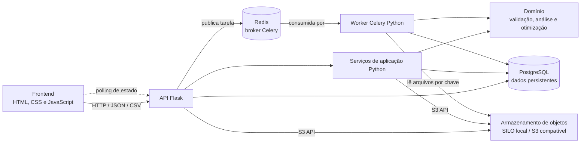
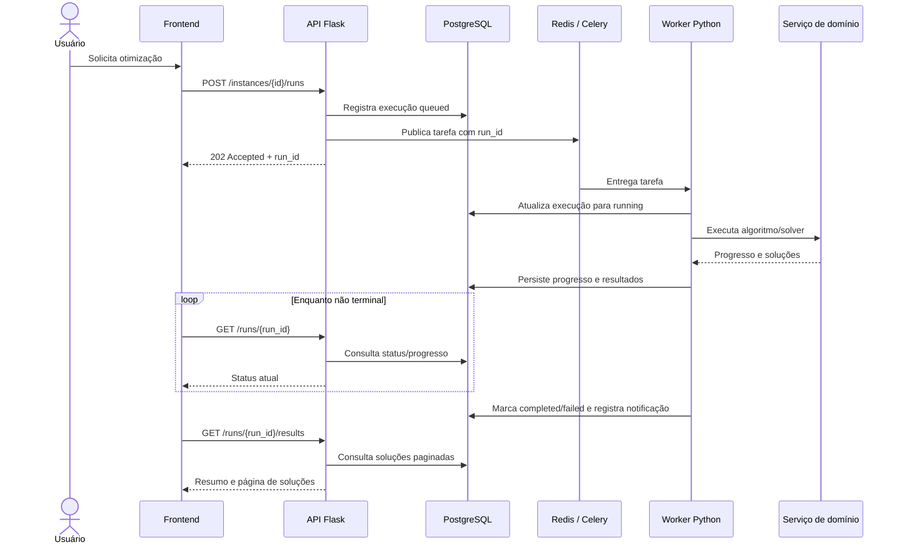
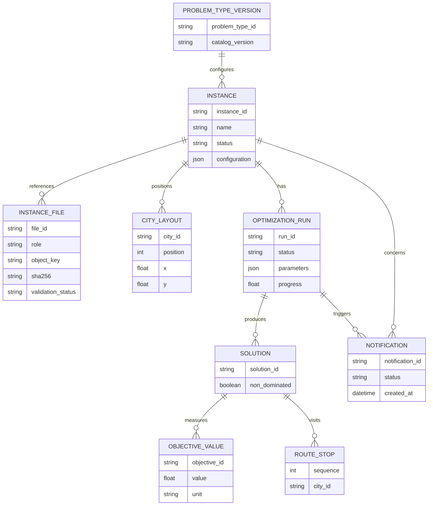

# WORKFLOW_INSTANCE — criação, execução e análise de instâncias

## Objetivo

Especificar o fluxo ponta a ponta para criar uma instância de otimização a partir de arquivos, inspecionar os dados, configurar e acompanhar uma execução assíncrona e analisar seus resultados. O catálogo de tipos de problema determina quais entradas, algoritmos e visualizações estão disponíveis.

Esta é uma especificação funcional. API, banco de dados e solvers ainda não estão integrados ao mockup. O protótipo navegável fica em [`mockups/`](./mockups/).

## Catálogo de tipos de problema

O catálogo deve ser a fonte de configuração do fluxo, evitando que telas mantenham listas independentes. Cada tipo publicado deve declarar:

| Informação | Conteúdo |
|---|---|
| Identificação | Código estável, nome, descrição e objetivos com nome, unidade e direção (minimizar/maximizar). |
| Entradas | Arquivos esperados, formato, validações e relação entre arquivos. |
| Análise prévia | Visualizações disponíveis e as entradas consumidas por cada visualização. |
| Solução | Modelos/algoritmos disponíveis, descrição e parâmetros configuráveis, quando aplicável. |
| Análise de resultados | Visualizações disponíveis, dados necessários e interpretações apresentadas. |

O cliente carrega essas opções a partir do catálogo do problema selecionado. A API/domínio deve validar novamente todas as escolhas; uma opção removida ou incompatível não pode ser aceita somente porque a interface a enviou.

### Entrada inicial do catálogo: TSP biobjetivo — tempo vs. distância

- **Objetivos:** minimizar tempo e minimizar distância.
- **Arquivos:** duas matrizes de adjacência CSV, uma para tempo e outra para distância; cada arquivo é uma matriz quadrada numérica sem cabeçalho. A ordem dos nós deve ser idêntica nos dois arquivos. Não presumir simetria.
- **Análise prévia:** grafo de arcos ponderados e heatmap da matriz de cada objetivo. No grafo, permitir configurar quantos vizinhos mais próximos mostrar por cidade; o padrão é 20, ordenado pelo menor tempo (minimizando esse objetivo) e excluindo a diagonal. Limitar a quantidade efetiva a `n - 1`, pois uma cidade não pode ter mais vizinhos do que as demais cidades da matriz. Mostrar claramente a quantidade solicitada e o limite disponível. Em matrizes assimétricas, selecionar os vizinhos de saída por cidade conforme sua própria linha; representar os arcos selecionados com direção. O grafo deve identificar qual peso/unidade está sendo mostrado; os heatmaps devem identificar objetivo, eixos/nós e escala.
- **Algoritmos:** a lista efetivamente selecionável deve vir das implementações disponíveis para esse tipo de problema. O mockup mostra ε-restrição como exemplo de opção, não como integração ou disponibilidade confirmada.
- **Análise dos resultados:** fronteira de Pareto (tempo × distância), tabela de soluções com valores/unidades e indicação de dominância. Cada linha oferece **Ver solução**, para desenhar somente os arcos da rota selecionada, e **Baixar resultado**, para exportar a sequência de cidades visitadas em CSV.

As coordenadas das cidades devem ser geradas uma vez para o grafo da instância e persistidas junto à instância/layout. O grafo de cada solução deve reutilizar exatamente esse conjunto de coordenadas; abrir diferentes soluções não deve recalcular a posição dos nós. O CSV de rota contém a ordem e identificador da cidade e inclui o retorno à cidade inicial, formando o ciclo do TSP.

Validações mínimas dos arquivos: extensão/formato aceito, conteúdo numérico finito, matriz não vazia e quadrada, dimensões iguais entre arquivos e correspondência da ordem dos nós. Erros devem apontar arquivo e, quando possível, linha/coluna. A regra para diagonal, separador decimal e limite de tamanho deve ser definida junto ao contrato de dados do domínio antes da integração.

## Fluxo do usuário

1. **Nova Instância:** escolher o tipo do problema, informar um nome e anexar todos os arquivos requeridos pelo catálogo. Para TSP, anexar os CSVs de tempo e distância em campos identificados separadamente. A interface valida presença, tipo e tamanho localmente; o servidor valida o conteúdo.
2. **Configuração:** avançar para revisar as visualizações de análise prévia e de resultados e selecionar o modelo/algoritmo. As opções e padrões vêm do tipo de problema. É necessário selecionar pelo menos uma visualização em cada etapa de análise e um algoritmo disponível.
3. **Criação:** confirmar em **Criar instância**. A instância é persistida com o tipo, nome, arquivos/referências e configuração. Ao concluir a criação, abrir seu dashboard em estado **Pronta para otimização**, apresentando a análise prévia.
4. **Execução:** **Otimizar** solicita uma execução assíncrona e retorna sem esperar o solver terminar. Mostrar estado, identificador/horário e progresso somente se fornecido pelo serviço. O usuário pode navegar para outras áreas e voltar ao dashboard.
5. **Cancelamento:** durante uma execução ativa, permitir **Cancelar otimização**. Exibir estado de cancelamento até a confirmação do serviço; só marcar como cancelada depois da confirmação. Resultados parciais, se existirem, não devem ser apresentados como execução concluída.
6. **Conclusão e análise:** ao receber estado concluído, habilitar **Visualizar resultados** e criar uma notificação no centro de notificações. A ação abre o dashboard da instância; a análise utiliza as visualizações escolhidas na criação.

## Estados e comportamento

Estados da instância: **Rascunho**, **Pronta para otimização**, **Em fila**, **Em execução**, **Cancelamento solicitado**, **Cancelada**, **Concluída** e **Falhou**. Erros de validação de entrada/configuração devem manter a instância editável; falha de execução deve oferecer a mensagem retornada pelo serviço e permitir uma nova tentativa sem ocultar o histórico.

| Situação | Comportamento esperado |
|---|---|
| Envio/criação em andamento | Indicar atividade e impedir submissões duplicadas; preservar os campos em caso de falha recuperável. |
| Execução ativa | Atualizar status sem bloquear a navegação; disponibilizar cancelamento e manter identificação da instância. |
| Serviço indisponível/erro | Informar que a ação não foi concluída e oferecer nova tentativa apropriada. Não mostrar sucesso fictício. |
| Cancelamento solicitado | Aguardar confirmação e representar claramente que a execução ainda pode estar encerrando. |
| Execução concluída | Habilitar análise e registrar notificação acessível por botão com nome e contador de não lidas. |
| Execução cancelada/falha | Não habilitar análise de resultados finais; mostrar status e mensagem correspondente. |

Notificações devem ser associadas à instância e à execução, persistir após navegação/atualização quando houver suporte de backend, e levar o usuário ao recurso relacionado. O status também deve ser obtido ao abrir o dashboard, não depender exclusivamente de a tela permanecer aberta.

## Diagramas da arquitetura

### Componentes e comunicação



O navegador comunica-se somente com a API. A API e os serviços de aplicação compartilham PostgreSQL e o armazenamento de objetos por interfaces próprias; o worker executa processamento pesado fora do ciclo HTTP. Redis transporta tarefas Celery, mas não armazena o estado durável da aplicação.

### Ciclo de uma otimização assíncrona



O cancelamento é solicitado por `POST /runs/{run_id}/cancel`; a API registra `cancel_requested` e sinaliza o worker. A execução só transita para `cancelled` depois de o worker confirmar o encerramento. Falhas ao publicar uma tarefa devem ser registradas e comunicadas, sem deixar uma execução indefinidamente em `queued`.

## API do backend

A API HTTP será implementada em Flask, com prefixo `/api/v1`. O processamento pesado (validação/análise de dados que possa bloquear, execução de algoritmos e solver) fica em serviços Python fora das rotas HTTP. As execuções serão enfileiradas com Celery usando Redis como broker; a API retorna sem aguardar o worker.

### Catálogo de problemas

| Método e endpoint | Responsabilidade |
|---|---|
| `GET /problem-types` | Listar os tipos publicados no catálogo. |
| `GET /problem-types/{problem_type_id}` | Obter objetivos, formatos de entrada, análises, algoritmos e parâmetros de um tipo. |

O catálogo é a fonte de opções da interface. A API valida as opções recebidas contra a versão/configuração vigente do catálogo.

### Upload e instâncias

| Método e endpoint | Responsabilidade |
|---|---|
| `POST /uploads` | Receber um ou mais arquivos via `multipart/form-data`, validar metadados básicos e armazená-los em área temporária. |
| `GET /uploads/{upload_id}` | Consultar estado, metadados e validade do upload temporário. |
| `POST /instances` | Criar a instância associando uploads, tipo e configuração. |
| `GET /instances` | Listar instâncias acessíveis ao usuário/workspace, com paginação e estado. |
| `GET /instances/{instance_id}` | Consultar metadados, configuração e estado da instância. |
| `PATCH /instances/{instance_id}` | Alterar nome/configuração se o estado permitir; não altera arquivos ou configuração usados por uma execução em andamento. |

O upload pode retornar `202 Accepted` quando a validação de conteúdo continuar em background; nesse caso, consultar `GET /uploads/{upload_id}` até ficar pronto ou inválido. A instância só pode ser criada com todos os uploads exigidos pelo tipo em estado válido. Para o TSP, o serviço Python valida que ambas as matrizes sejam quadradas, tenham dimensões e ordem de cidades iguais e contenham pesos numéricos válidos.

Exemplo de criação:

```http
POST /api/v1/instances
Content-Type: application/json
```

```json
{
  "problem_type_id": "tsp-time-distance",
  "name": "TSP — Belo Horizonte",
  "files": {
    "time_matrix": "upload_123",
    "distance_matrix": "upload_456"
  },
  "configuration": {
    "preview": ["weighted_graph", "matrix_heatmap"],
    "result_views": ["pareto_frontier", "solutions_table"],
    "algorithm_id": "epsilon-constraint",
    "parameters": {}
  }
}
```

Resposta `201 Created` inclui a instância criada, estado `ready` e links para sua análise. `algorithm_id` é ilustrativo e só deve ser aceito se estiver disponível no catálogo/ambiente.

### Análise dos dados de entrada

| Método e endpoint | Responsabilidade |
|---|---|
| `GET /instances/{instance_id}/analysis/input/graph?objective=time&neighbors_per_city=20` | Retornar cidades e arcos de entrada filtrados pelos vizinhos mais próximos. |
| `GET /instances/{instance_id}/analysis/input/matrix?objective=time` | Retornar a matriz e metadados necessários ao heatmap. |

Exemplo de resposta do grafo:

```json
{
  "objective": {
    "id": "time",
    "label": "Tempo",
    "unit": "min",
    "direction": "minimize"
  },
  "neighbors_per_city": {
    "requested": 20,
    "effective": 5
  },
  "nodes": [
    { "id": "A", "label": "A", "x": 92, "y": 124 },
    { "id": "B", "label": "B", "x": 201, "y": 49 }
  ],
  "edges": [
    { "source": "A", "target": "B", "weight": 18 }
  ]
}
```

`neighbors_per_city` é uma preferência de visualização, não altera os dados da instância nem a otimização. O valor efetivo não pode exceder `n - 1`; selecionar vizinhos por linha/origem e preservar direção em matrizes assimétricas. O serviço gera e persiste uma disposição de coordenadas por instância, reutilizada tanto neste endpoint quanto no grafo de cada solução.

### Execuções assíncronas

| Método e endpoint | Responsabilidade |
|---|---|
| `POST /instances/{instance_id}/runs` | Criar uma execução e enfileirar a tarefa Celery. |
| `GET /instances/{instance_id}/runs` | Listar o histórico de execuções da instância. |
| `GET /runs/{run_id}` | Consultar estado, progresso e timestamps da execução. |
| `POST /runs/{run_id}/cancel` | Solicitar cancelamento da tarefa em andamento. |

Iniciar execução:

```http
POST /api/v1/instances/{instance_id}/runs
Idempotency-Key: 60c575c3-...
Content-Type: application/json
```

```json
{
  "algorithm_id": "epsilon-constraint",
  "parameters": {}
}
```

A API valida a instância e a configuração, cria o registro da execução, publica uma tarefa Celery e responde `202 Accepted`:

```json
{
  "run_id": "run_789",
  "instance_id": "inst_123",
  "status": "queued",
  "status_url": "/api/v1/runs/run_789"
}
```

O worker Python consome a tarefa, atualiza o estado e progresso no armazenamento persistente, executa o serviço de domínio/solver e grava resultados ou erro. Celery/Redis transportam tarefas e sinais de execução; Redis não é a fonte permanente de estado, resultados ou notificações. A chave `Idempotency-Key` evita iniciar execuções duplicadas em reenvios da mesma solicitação.

Estados de execução: `queued`, `running`, `cancel_requested`, `cancelled`, `completed` e `failed`. O cancelamento retorna `202 Accepted` quando solicitado e permanece `cancel_requested` até confirmação do worker. Uma solicitação repetida é idempotente; só marcar `cancelled` depois de o worker confirmar.

A primeira versão do cliente pode consultar `GET /runs/{run_id}` por polling com intervalo progressivo. `GET /events` pode oferecer atualizações via Server-Sent Events como evolução; não é necessário para iniciar a integração.

### Resultados, soluções e exportação

| Método e endpoint | Responsabilidade |
|---|---|
| `GET /runs/{run_id}/results` | Retornar resumo da execução e página de soluções. |
| `GET /runs/{run_id}/solutions/{solution_id}` | Consultar objetivos, valores, unidades e rota de uma solução. |
| `GET /runs/{run_id}/solutions/{solution_id}/graph` | Retornar somente os arcos da solução e as coordenadas persistidas da instância. |
| `GET /runs/{run_id}/solutions/{solution_id}/route.csv` | Baixar a sequência ordenada de cidades visitadas, incluindo o retorno à origem. |

Os endpoints de resultados só retornam dados finais quando a execução estiver `completed`; enquanto estiver ativa, respondem conflito com o estado corrente. As listas de soluções devem ser paginadas. O CSV é servido com `Content-Type: text/csv` e `Content-Disposition: attachment`.

### Notificações

| Método e endpoint | Responsabilidade |
|---|---|
| `GET /notifications` | Listar notificações do usuário/workspace com paginação e estado de leitura. |
| `PATCH /notifications/{notification_id}` | Marcar uma notificação como lida. |

Ao concluir uma execução, o serviço de aplicação registra uma notificação ligada à instância e à execução. O cliente pode navegar a partir dela para a execução correspondente. A notificação deve ser persistida junto ao armazenamento da aplicação, não somente em Redis.

### Arquitetura de execução

1. Flask autentica/autorizada a solicitação e executa validações rápidas de contrato e estado.
2. Serviços de aplicação/domain validam os dados e regras do problema; não dependem diretamente de Flask ou Celery.
3. Para processamento demorado, a API registra a execução e envia uma tarefa Celery para Redis, respondendo `202 Accepted`.
4. Um ou mais workers Celery executam serviços Python de análise/otimização e persistem progresso, resultado e falha no armazenamento da aplicação.
5. A API lê o estado persistido para polling, serve resultados e registra notificações.

O envio da tarefa e a persistência da execução devem ser coordenados para evitar execução sem registro ou registro preso em `queued` se a publicação falhar. Erros de publicação devem ser reportados; uma estratégia de outbox pode ser adotada se necessária para garantir consistência.

## Persistência

### Decisões adotadas

| Dado | Persistência | Uso |
|---|---|---|
| Metadados de instâncias, uploads, execuções e notificações | PostgreSQL | Fonte persistente e transacional para a API e os workers; consultas, paginação, estados e relacionamentos. |
| Matrizes e demais arquivos de entrada | Armazenamento de objetos compatível com S3 | Upload/download por chave; não guardar o conteúdo integral dos arquivos no banco relacional. |
| Soluções e valores dos objetivos | PostgreSQL inicialmente | Consultar, filtrar e paginar soluções e seus objetivos sem carregar um artefato inteiro. Arquivos de resultados podem complementar essa estratégia se volume medido justificar. |
| Catálogo de tipos de problemas | Arquivos JSON versionados no repositório | Revisão por código e histórico; cada instância/execução registra a versão usada. |
| Tarefas Celery | Redis | Broker para enfileirar tarefas e sinais de execução; não é fonte permanente de metadados, status, resultados ou notificações. |

### Armazenamento de objetos S3 compatível

O ambiente local deve subir, em container, uma implementação de armazenamento compatível com a API S3, usando **SILO** como opção para esse serviço. A aplicação acessa-o por uma interface/configuração S3 padrão, sem acoplar o domínio ao produto. Isso permite trocar SILO por um serviço S3 gerenciado em outro ambiente sem alterar os serviços de aplicação.

Armazenar no bucket os arquivos enviados, com chaves opacas e não previsíveis. No PostgreSQL guardar apenas referências e metadados, incluindo papel do arquivo, chave do objeto, nome original, tamanho, hash SHA-256, tipo de conteúdo, estado da validação e timestamps. O nome original não deve ser usado diretamente como chave. Aplicar limites de tamanho e limpeza de uploads temporários/órfãos conforme política de retenção.

Os CSVs são validados por serviço Python antes de serem associados a uma instância pronta. O worker pode ler os objetos pelo serviço de armazenamento usando a chave registrada; não deve depender de compartilhar um diretório local com a API. Em desenvolvimento, endpoint, bucket e credenciais são configuração externa ao código; credenciais locais não devem ser incluídas no repositório. Produção deve usar credenciais e políticas próprias do ambiente, além de transporte seguro.

### Dados relacionais e reprodutibilidade

O PostgreSQL guarda metadados e resultados estruturados. Entidades/tabelas conceituais:

- **Problem type/version:** identificador estável e versão do catálogo correspondente ao arquivo JSON versionado.
- **Instance:** tipo e versão do catálogo, nome, workspace/proprietário, estado, configuração imutável usada na criação e timestamps.
- **Instance file:** instância, papel no problema (por exemplo, matriz de tempo), chave S3, checksum, tamanho e estado de validação.
- **City/node layout:** instância, identificador/ordem da cidade e coordenadas. Gerar uma vez e reutilizar nos grafos de entrada e das soluções.
- **Optimization run:** instância, algoritmo e parâmetros congelados, versão de código/modelo quando disponível, estado, progresso, timestamps e erro sanitizado.
- **Solution:** execução, identificador, status de dominância e metadados.
- **Objective value:** solução, identificador do objetivo, valor numérico e unidade/direção referenciadas ao catálogo.
- **Route stop:** solução, posição e identificador da cidade; preservar a ordem da rota e incluir o retorno à origem no TSP.
- **Notification:** usuário/workspace, execução/instância relacionada, tipo, estado de leitura e data.



Os nomes acima descrevem o modelo lógico; a implementação pode normalizá-lo de acordo com as convenções do projeto. Evitar serializar todos os resultados em um único JSON quando eles precisarem de paginação, filtros ou ordenação. Se execuções reais demonstrarem volume excessivo, arquivar dados detalhados em objetos (por exemplo, Parquet/JSONL) e manter no PostgreSQL resumo, índices e dados necessários às consultas comuns.

Cada execução deve guardar a configuração efetiva e as versões do catálogo e do algoritmo/modelo, para que alterações futuras não modifiquem a interpretação dos resultados existentes. Redis e o estado interno do backend Celery não substituem o registro transacional da execução no PostgreSQL. Transições de estado e resultados devem ser persistidos pela aplicação/worker; tarefas repetidas devem ser idempotentes em relação ao identificador da execução.

### SQLite e ambientes

PostgreSQL é o banco principal da aplicação devido às gravações concorrentes da API e dos workers, transações e consultas relacionais. SQLite permanece adequado para testes unitários isolados ou experimentação local simplificada, mas não será o alvo do ambiente integrado da feature.

O compose de desenvolvimento da aplicação deverá orquestrar os serviços necessários — API Flask, worker Celery, Redis, PostgreSQL, serviço S3 compatível SILO e frontend quando aplicável — com volumes persistentes para banco e objetos. Segredos devem ser fornecidos por variáveis/arquivos locais não versionados. Migrações versionadas devem inicializar e evoluir o esquema PostgreSQL; o bucket e suas configurações iniciais devem ser preparados de forma repetível.

### Erros HTTP

Usar corpo padronizado, por exemplo:

```json
{
  "error": {
    "code": "invalid_matrix",
    "message": "A matriz de tempo deve ser quadrada.",
    "details": [
      { "file": "tempo.csv", "row": 4, "column": 2 }
    ]
  }
}
```

- `400 Bad Request`: formato/parâmetro ausente ou inválido.
- `401 Unauthorized` / `403 Forbidden`: usuário não autenticado ou sem acesso ao recurso.
- `404 Not Found`: upload, instância, execução, solução ou notificação inexistente/acessível.
- `409 Conflict`: operação incompatível com o estado atual, incluindo consulta prematura de resultados.
- `413 Payload Too Large`: upload acima do limite.
- `422 Unprocessable Entity`: arquivo, matriz ou configuração semanticamente inválidos.
- `503 Service Unavailable`: fila/broker indisponível ou serviço necessário temporariamente fora do ar.

Mensagens de erro não devem conter stack traces nem ser convertidas em estados de sucesso.

## Critérios de aceite

1. O usuário consegue selecionar tipo, nome e todos os arquivos obrigatórios; arquivos ausentes ou incompatíveis são indicados antes da criação.
2. O passo de configuração apresenta somente gráficos e algoritmos associados ao tipo escolhido, permite confirmar preferências e impede configuração incompleta.
3. Após criar a instância, o dashboard exibe as análises prévias configuradas e identifica os dados/orientação/unidades apresentados.
4. A execução é iniciada de forma assíncrona; o usuário pode navegar para outra área sem perder o vínculo com a execução.
5. Durante a execução, o usuário consegue solicitar cancelamento e acompanha a confirmação/status final sem ver a execução falsamente concluída.
6. Depois da conclusão, **Visualizar resultados** só então fica habilitado, mostra as análises configuradas e uma notificação direciona à instância.
7. Erros de upload, validação, criação, execução, consulta e cancelamento são comunicados sem serem convertidos em sucesso.
8. A tabela pós-otimização oferece **Ver solução** e **Baixar resultado** para cada alternativa. O grafo da solução exibe apenas seus arcos, e as posições das cidades coincidem com o grafo de entrada.
9. O CSV exportado apresenta a sequência ordenada de cidades, incluindo o retorno à origem.
10. O grafo prévio inicia com o parâmetro 20, exibe por cidade até `n - 1` vizinhos ordenados pelo menor peso e se atualiza ao alterar o parâmetro.
11. O fluxo funciona por teclado, tem rótulos e estados anunciáveis por tecnologia assistiva, e não depende exclusivamente de cor.
12. Em larguras móveis e desktop, etapas, gráficos, arquivos e ações permanecem legíveis e utilizáveis.

## Mockup e limites

Abra [`mockups/index.html`](./mockups/index.html) diretamente ou sirva a pasta `mockups/` com um servidor estático. O protótipo usa somente HTML, CSS e JavaScript vanilla.

Os nomes, matrizes, grafo, estados do solver e resultados do protótipo são ilustrativos. A seleção de arquivos ocorre somente no navegador; não há leitura/upload real, validação de domínio, persistência, API, notificações em segundo plano ou solver. O botão de otimização simula conclusão/cancelamento localmente para demonstrar a interação.

Na visualização do mockup, o controle começa em 20 vizinhos por cidade e ordena pelo tempo. Como o exemplo tem seis cidades, o limite efetivo é cinco vizinhos por cidade. A disposição fixa A–F é armazenada no estado JavaScript da instância e compartilhada pelo grafo de entrada e pelos grafos de rota. O CSV baixado contém os dados fictícios da solução demonstrativa selecionada.

## Decisões pendentes para a integração

- Contrato de CSV (codificação, separador, cabeçalho, separador decimal), regra de diagonal e tamanho máximo.
- Algoritmos e parâmetros realmente disponíveis para cada tipo de problema.
- Política de cancelamento cooperativo dos workers e formato/periodicidade do progresso.
- Limites de tamanho/retensão dos arquivos e resultados, autenticação/autorização do workspace e produto/versão SILO a usar no compose de desenvolvimento.
- Frequência e retenção de notificações, incluindo comportamento com múltiplas execuções por instância.
