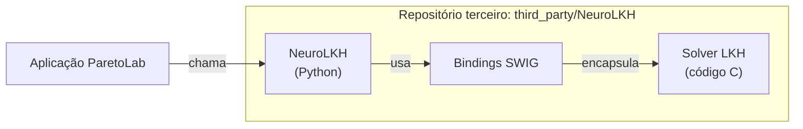
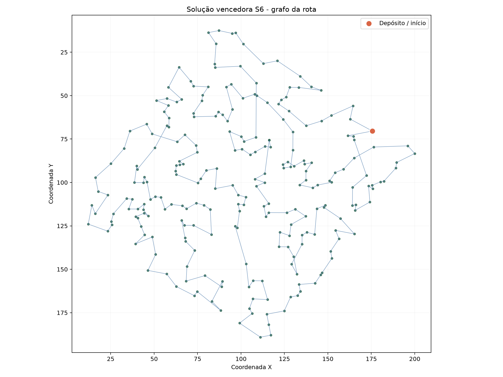
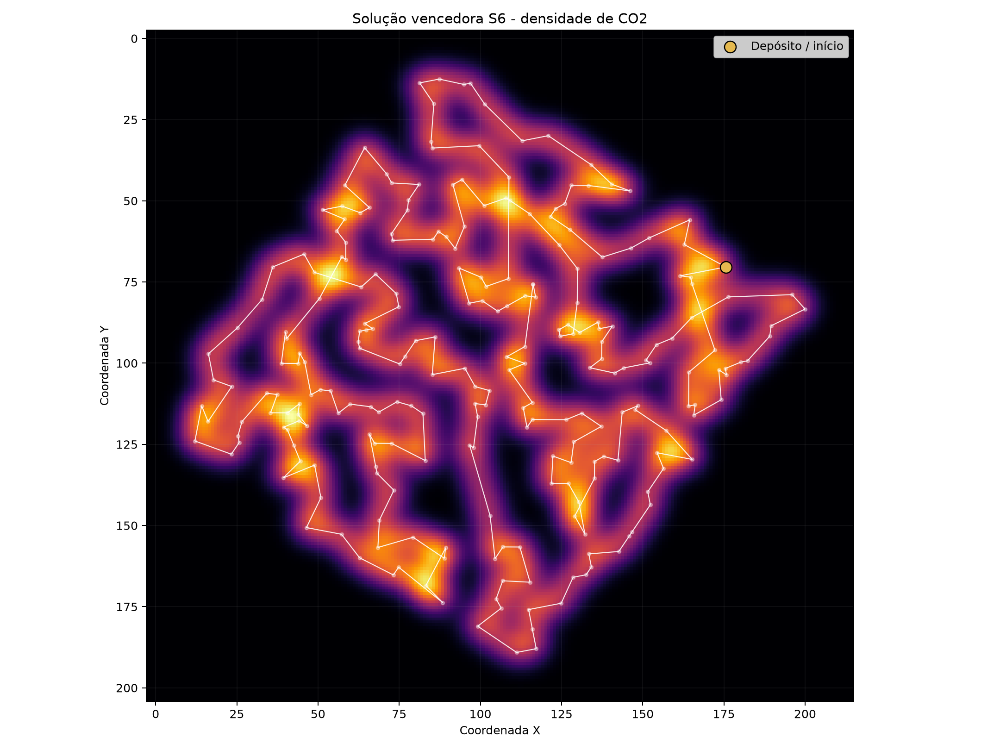
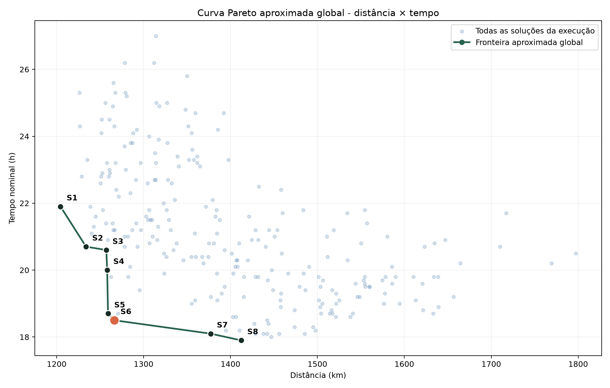

# Relatório de tomada de decisão

## Contexto da análise

Este relatório foi gerado a partir dos dados persistidos no PostgreSQL da instância `inst_1f56c2c435ad4faabf7beeefc811ac7a` e da execução concluída `run_cc44931f62fb4f6f9de63261fb58c9fb`.

- Instância: `TSP BIOBJETIVO`
- Nós da instância: 250
- Algoritmo: `neuro-lkh`
- Execução: 50 iterações e 5 repetições
- Semente: `4180680559`
- Soluções persistidas: 250
- Marcas não dominadas acumuladas por rodada: 26
- Fronteira aproximada global, recalculada sobre todas as soluções: 8 pontos
- Alternativas incluídas no ranking AHP persistido: 8

A execução produziu uma aproximação da fronteira de Pareto, não uma fronteira ótima garantida.

## Algoritmo NeuroLKH

NeuroLKH combina uma rede neural com a heurística Lin-Kernighan-Helsgaun (LKH) para resolver o Problema do Caixeiro-Viajante. A rede não constrói a rota diretamente: ela aprende padrões que ajudam a busca local do LKH a priorizar conexões promissoras. O LKH, por sua vez, continua responsável por construir e melhorar as rotas. Por ser uma heurística, o método não garante encontrar a solução ótima.

### Organização do código e integração

O código original do NeuroLKH é mantido como submódulo Git em `third_party/NeuroLKH`. Isso permite manter a dependência separada do código do ParetoLab e vinculada a uma revisão específica do repositório externo; atualizações do projeto original não alteram automaticamente a revisão utilizada aqui.

A busca LKH é implementada em C. Em vez de reimplementá-la em Python, o projeto a encapsula por meio das bindings SWIG fornecidas junto ao NeuroLKH: uma camada Python prepara a instância e os dados da rede, chama o solver C e recebe a rota resultante. Assim, a integração preserva o algoritmo de busca nativo e oferece uma interface compatível com os demais solucionadores do projeto.



O NeuroLKH é mantido como repositório terceiro em `third_party/NeuroLKH` e chamado pela aplicação ParetoLab. Dentro desse repositório, as bindings SWIG conectam a implementação Python ao solver LKH em C.

### Rede pré-treinada

O NeuroLKH usa uma Sparse Graph Network (SGN) treinada previamente, fora da execução de cada rota. Durante o treinamento, a rede aprende duas informações complementares: pontuações para as arestas, com supervisão baseada em soluções de referência, e penalidades para os nós, por meio de um objetivo não supervisionado relacionado ao grau dos nós em uma árvore 1-mínima. Os pesos resultantes são armazenados e carregados para inferência; a rede não é treinada novamente a cada execução analisada.

Para resolver uma instância, a SGN recebe uma representação esparsa do grafo e estima pontuações de arestas e penalidades de nós. As pontuações orientam a escolha do conjunto de arestas candidatas do LKH. As penalidades ajustam os custos usados para orientar a busca, sem mudar o custo da rota original. Com essas informações, o LKH realiza várias tentativas e retorna a melhor rota encontrada.

### Pseudocódigo conceitual

O treinamento é realizado previamente para que a rede possa ser reutilizada em instâncias posteriores:

```text
TreinarNeuroLKH(instâncias de treinamento):
    para cada instância:
        construir uma representação esparsa do grafo
        aprender pontuações de arestas a partir das rotas de referência
        aprender penalidades de nós com o objetivo não supervisionado
    salvar os pesos treinados da rede
```

Na resolução de uma instância, os pesos salvos orientam a busca heurística:

```text
ResolverNeuroLKH(instância, rede pré-treinada, número de tentativas):
    representar a instância como um grafo esparso
    inferir pontuações das arestas e penalidades dos nós
    criar o conjunto de arestas candidatas a partir das pontuações
    ajustar os custos de busca usando as penalidades
    melhor_rota ← nenhuma
    repetir o número de tentativas:
        inicializar uma rota
        aplicar movimentos λ-opt do LKH usando as arestas candidatas
            até que não seja encontrada melhoria
        se a rota for melhor que melhor_rota:
            melhor_rota ← rota
    retornar melhor_rota
```

Essa descrição segue a proposta de Xin et al. (2021): a SGN aprende a orientar a geração de candidatos e a transformação de custos, enquanto a busca λ-opt do LKH explora e melhora as rotas.

**Referência teórica:** XIN, Liang; SONG, Wen; CAO, Zhiguang; ZHANG, Jie. *NeuroLKH: Combining Deep Learning Model with Lin-Kernighan-Helsgaun Heuristic for Solving the Traveling Salesman Problem*. Advances in Neural Information Processing Systems (NeurIPS), 2021. O artigo está em `docs/papers/15-XIN, Zichuan et al. NeuroLKH combining deep learning and heuristic search for the traveling salesman problem. Advances in Neural Information Processing Systems.pdf`.

## Processo de tomada de decisão

O processo combina duas etapas:

1. **Otimização e análise de robustez**
   - As rotas foram avaliadas em 5.000 cenários Monte Carlo.
   - Semente da simulação: 42.
   - Coeficiente de variação dos tempos dos arcos: 20%.
   - Correlação regional intra-arco: 30%.
   - Convenção dos tempos aleatórios: preservação da média nominal.
   - Avaliação dividida em 8 regiões espaciais obtidas por k-means nos pontos médios dos arcos.

2. **Priorização multicritério pelo AHP**
   - Foram usados quatro critérios: distância, tempo nominal, emissão de CO2 e Min-Max Regret.
   - O decisor realizou comparações par a par na escala de Saaty.
   - Os pesos dos critérios foram obtidos pelo vetor de prioridades da matriz.
   - As alternativas receberam pesos locais normalizados pelo desempenho em cada critério.
   - A pontuação global foi calculada pela soma do peso de cada critério multiplicado pelo peso local da alternativa.

### Critérios de preferência

| Critério | Peso global | Preferência observada |
|---|---:|---|
| Tempo nominal | 44,20% | Critério predominante |
| Min-Max Regret | 25,71% | Forte importância relativa à distância |
| Emissão de CO2 | 24,65% | Importância intermediária |
| Distância | 5,44% | Critério com menor peso |

#### Critério de emissão de CO2

A emissão de CO2 é uma estimativa determinística associada a cada rota, não um dos objetivos usados pelo otimizador para construir a aproximação da fronteira de Pareto. O cálculo usa as matrizes persistidas de distância e tempo, ambas convertidas para quilômetros e horas.

Para cada arco da rota:

1. Calcula-se a velocidade pela relação `velocidade = distância / tempo`.
2. Pela faixa de velocidade, atribui-se um fator de emissão:
   - abaixo de 20 km/h: `1,50`;
   - de 20 km/h até menos de 40 km/h: `1,15`;
   - de 40 km/h até menos de 70 km/h: `1,00`;
   - a partir de 70 km/h: `1,20`.
3. A emissão do arco é calculada por `distância × 0,30 kg CO2/km × fator da velocidade`.
4. A emissão da solução é a soma das emissões de todos os arcos percorridos.

O fator-base de `0,30 kg CO2/km` é uma premissa do modelo e não representa uma medição universal para todos os veículos ou condições de operação. Velocidades muito baixas recebem fator maior, porque o modelo atribui maior consumo relativo a esse regime. O fator total da rota é a média dos fatores ponderada pelas distâncias:

```text
fator_total = CO2_total / (distância_total × 0,30)
```

Um fator total de `1,09`, por exemplo, indica uma emissão 9% acima da referência-base da mesma distância. Para arcos sem velocidade calculável, o modelo usa fator neutro `1,00`. A emissão não é recalculada em cada cenário de incerteza: a análise Monte Carlo perturba os tempos para avaliar robustez, mas mantém fixas as rotas e a estimativa determinística de CO2.

Na execução analisada, S6 emite `414,3915 kg CO2`. Esse valor corresponde a `379,89 kg` pela referência-base e a um excesso de `34,5015 kg`, com fator total de velocidade `1,09082`. Dentre os concorrentes, S1 tem a menor emissão absoluta, `390,0945 kg`, enquanto S8 tem a maior, `469,6680 kg`. Emissões maiores ou menores devem ser interpretadas junto da distância percorrida, pois uma rota mais longa pode emitir mais mesmo com fator de velocidade menor.

#### Critério Min-Max Regret

O Min-Max Regret representa o pior arrependimento relativo da solução entre os critérios de distância e tempo. Ele transforma o desempenho da alternativa em duas razões normalizadas e utiliza a maior delas como pontuação.

Primeiro, o regret relativo à distância é calculado em relação à menor distância do conjunto:

```text
regret_distância = (distância da solução - distância mínima) / distância mínima
```

Em seguida, o time regret é obtido pela análise de robustez Monte Carlo. Para cada solução e cenário, o tempo realizado é comparado com o melhor tempo do conjunto naquele cenário. A implementação do ParetoLab considera duas versões normalizadas:

```text
regret_tempo_médio = regret_médio da solução / menor tempo médio do conjunto
regret_tempo_P95 = regret_P95 da solução / menor tempo médio do conjunto
```

A pontuação Min-Max Regret usada no ranking principal é:

```text
Min-Max Regret = máximo(regret_distância, regret_tempo_médio)
```

O relatório também conserva uma versão P95:

```text
Min-Max Regret P95 = máximo(regret_distância, regret_tempo_P95)
```

Assim, uma solução é penalizada pelo maior desvio relativo observado entre distância e tempo. Valores menores indicam menor risco de arrependimento, independentemente de a solução vencer apenas em um dos objetivos. A medida depende do conjunto analisado: o máximo, o mínimo e os regrets devem ser recalculados ao incluir ou excluir alternativas.

No ranking analisado, S6 apresenta `0,0513949` de Min-Max Regret e `0,0651419` na versão P95. S5 é a alternativa com menor regret médio, `0,0478831`, enquanto S1 apresenta o maior valor entre os concorrentes, `0,2266580`. Em termos médios, S6 fica 0,0035118 acima de S5, mas o ranking global atribui peso maior ao tempo nominal e ao Min-Max Regret.

Os julgamentos persistidos foram:

| Comparação par a par | Julgamento |
|---|---:|
| Distância em relação ao tempo | 1/9 |
| Distância em relação ao CO2 | 1/3 |
| Distância em relação ao Min-Max Regret | 1/5 |
| Tempo em relação ao CO2 | 3 |
| Tempo em relação ao Min-Max Regret | 1 |
| CO2 em relação ao Min-Max Regret | 2 |

Portanto, o decisor considerou o **tempo nominal muito mais importante que a distância**, deu peso moderado ao tempo em relação ao CO2 e tratou tempo e Min-Max Regret como igualmente importantes. Os demais pares não informados foram considerados com julgamento neutro igual a 1.

## Validade dos julgamentos

A matriz dos quatro critérios produziu:

- Autovalor máximo λmax: `4,3308`
- Índice de consistência: `0,1103`
- Razão de consistência: `12,25%`

A Razão de Consistência excede o limite recomendado de 10%. Assim, o ranking é **provisório** e os julgamentos deveriam ser revisados, apesar de o relatório já estar persistido no banco. Em particular, a diferença entre a primeira e a segunda alternativa é pequena o suficiente para tornar essa revisão relevante.

## Cenário vencedor

A alternativa vencedora é **S6**, identificada no banco como `sol_b0eb4bcb0a684a55bc096fc77518d2da`.

| Característica | Valor |
|---|---:|
| Posição no ranking AHP | 1 |
| Pontuação AHP | 17,284% |
| Distância | 1.266,30 km |
| Tempo nominal | 18,50 h |
| Emissão de CO2 | 414,3915 kg |
| CO2 base pela distância | 379,89 kg |
| Excesso por fator de velocidade | 34,5015 kg |
| Fator total de emissão por velocidade | 1,09082 |
| Arcos da rota | 249 |
| Min-Max Regret | 0,0513949 |
| P95 do Min-Max Regret | 0,0651419 |
| Probabilidade de pertencer à fronteira | 73,88% |
| Frequência de vitória em tempo | 1,96% |
| Tempo médio simulado | 18,5035 h |
| P95 do tempo | 19,7956 h |
| P99 do tempo | 20,4055 h |
| CVaR95 do tempo | 20,1620 h |
| Desvio-padrão do tempo | 0,7742 h |
| CV do tempo | 4,1842% |
| Regret médio em tempo | 0,6450 h |
| Regret P95 em tempo | 1,1671 h |
| Contribuição ao hipervolume | 32,0058 |

S6 apresenta um compromisso equilibrado entre tempo e robustez. Sua distância é intermediária entre os extremos da fronteira, seu tempo nominal fica próximo do melhor extremo de tempo e seu Min-Max Regret é o segundo menor dos oito concorrentes, atrás apenas de S5.





## Comparação dos concorrentes

| Rank | Solução | Distância (km) | Tempo (h) | CO2 (kg) | Min-Max Regret | Prob. fronteira | Pontuação AHP |
|---:|---|---:|---:|---:|---:|---:|---:|
| 1 | S6 | 1.266,3 | 18,5 | 414,3915 | 0,0513949 | 73,88% | 17,2844% |
| 2 | S5 | 1.259,1 | 18,7 | 411,2220 | 0,0478831 | 100,00% | 17,1933% |
| 3 | S7 | 1.377,2 | 18,1 | 456,5730 | 0,1434739 | 85,10% | 12,7747% |
| 4 | S4 | 1.258,1 | 20,0 | 410,1105 | 0,1204109 | 95,36% | 12,7000% |
| 5 | S8 | 1.412,2 | 17,9 | 469,6680 | 0,1725340 | 71,52% | 11,5058% |
| 6 | S2 | 1.233,8 | 20,7 | 402,5910 | 0,1597029 | 99,82% | 10,7413% |
| 7 | S3 | 1.257,1 | 20,6 | 412,2990 | 0,1541186 | 60,06% | 10,4802% |
| 8 | S1 | 1.204,4 | 21,9 | 390,0945 | 0,2266580 | 100,00% | 7,3204% |

Os oito itens acima são as alternativas persistidas no ranking AHP. Todas as oito alternativas são não dominadas dentro do conjunto considerado pelo ranking; no entanto, somente S1, S2, S3, S4, S5, S6, S7 e S8 compõem a fronteira aproximada global de 8 pontos.

### Características dos concorrentes

- **S5 — principal concorrente:** menor distância entre as soluções lideradas pelo tempo e menor Min-Max Regret. A pontuação fica apenas 0,091 ponto percentual abaixo de S6. Em compensação, possui probabilidade de pertencer à fronteira de 100%, tempo de 18,7 h e CO2 de 411,222 kg.
- **S7:** uma alternativa mais rápida que S6, com 18,1 h, porém mais distante e com emissão muito maior. Seu Min-Max Regret é aproximadamente 2,8 vezes o de S6.
- **S4:** distância próxima à de S6 e menor CO2, mas com tempo nominal de 20 h e Min-Max Regret maior.
- **S8:** melhor extremo nominal de tempo, com 17,9 h, mas a maior distância e a maior emissão entre os oito concorrentes. Seu Min-Max Regret é o segundo maior.
- **S2:** menor distância do ranking apenas entre os oito, mas com tempo nominal elevado de 20,7 h e CO2 intermediário.
- **S3:** distância e CO2 próximos de S6, porém com tempo nominal de 20,6 h e Regret maior.
- **S1:** menor distância real e menor CO2 absoluto, mas o maior tempo nominal, 21,9 h, e o maior Min-Max Regret. Sua eficiência em distância/CO2 não compensa o peso elevado dado ao tempo.

## Curva de Pareto mapeada

### Como a curva foi obtida

A imagem foi corrigida. Ela não usa a marcação de dominância calculada separadamente em cada rodada. Para obter a **fronteira aproximada global**, foram consideradas as 250 soluções persistidas da execução e aplicada a relação de dominância sobre a união:

- O objetivo é minimizar distância e tempo.
- Uma solução candidata é dominada quando existe outra solução com distância não maior e tempo não maior, sendo melhor em pelo menos um desses dois objetivos.
- Uma solução pertence à curva apenas quando não é dominada por nenhuma outra solução da união.
- Os pontos resultantes foram ordenados pela distância.

Nesse método, a curva aproximada global contém **8 soluções**. Nenhum desses pontos domina o outro, nem é dominado por outro ponto da própria fronteira.

As 26 marcas `non_dominated` anteriores eram a soma dos pontos não dominados dentro de cada rodada. Esse conjunto acumulado não corresponde à fronteira global: ele pode conter soluções dominadas por alternativas encontradas em outras rodadas. Por isso, não foi usado para a curva corrigida.



Os extremos aproximados da fronteira são:

- Distância mínima: 1.204,40 km, com tempo nominal de 21,90 h.
- Tempo mínimo: 17,90 h, com distância de 1.412,20 km.

O vencedor S6 está na região intermediária da curva, com 1.266,30 km e 18,50 h. A proximidade com a solução S5 permite observar que o efeito da preferência definida pelos julgamentos é o fator decisivo para o primeiro lugar: sem a predominância do tempo e do Regret, alternativas mais curtas poderiam substituir S6.

## Conclusão

O processo de decisão selecionou **S6** porque combina um tempo nominal baixo, o segundo menor Min-Max Regret e um nível intermediário de distância e emissão. Apesar de não ser o melhor isolado em nenhum dos quatro critérios, ela apresenta o melhor equilíbrio segundo os pesos derivados dos julgamentos persistidos.

O resultado não deve ser tratado como definitivo enquanto a Razão de Consistência permanecer acima de 10%. Uma revisão das preferências, especialmente das comparações entre tempo, CO2 e Min-Max Regret, pode alterar a liderança entre S6 e S5.
